# Voxium - Architecture Document

## Table of Contents

1. [System Overview](#system-overview)
2. [High-Level Architecture](#high-level-architecture)
3. [Technology Stack](#technology-stack)
4. [Backend Architecture](#backend-architecture)
5. [Frontend Architecture](#frontend-architecture)
6. [Database Design](#database-design)
7. [Real-Time Communication](#real-time-communication)
8. [Voice Architecture](#voice-architecture)
9. [End-to-End Encryption](#end-to-end-encryption)
10. [Authentication & Security](#authentication--security)
11. [Scalability Strategy](#scalability-strategy)
12. [Deployment Architecture](#deployment-architecture)
13. [Future Architecture](#future-architecture)

---

## System Overview

Voxium is a real-time communication platform enabling users to create communities (called spaces in the app; `server` in the code, API and database), organize conversations into channels, and communicate via text messages and voice chat. The system is designed to handle 1,000+ concurrent users in V1, with a clear path to scale to millions.

### Core Principles

- **Real-time first:** All interactions are immediately reflected across connected clients
- **Low latency:** Voice and messaging prioritize sub-100ms delivery
- **Horizontal scalability:** The code is multi-node correct (production runs one instance today) — Socket.IO Redis adapter, Redis-backed shared state, channel-affinity voice relay with crash takeover
- **Cross-platform:** Single codebase serves Windows, macOS, Linux, and web browsers (future: mobile)
- **Privacy-first:** No third-party services — all traffic stays on user's own infrastructure
- **End-to-end encrypted where it matters:** DMs (always on), invite-only secure channels (text and voice), and DM call signaling use Olm/Megolm; the server stores ciphertext it cannot read
- **Security:** JWT auth, input validation, rate limiting, CORS protection

---

## High-Level Architecture

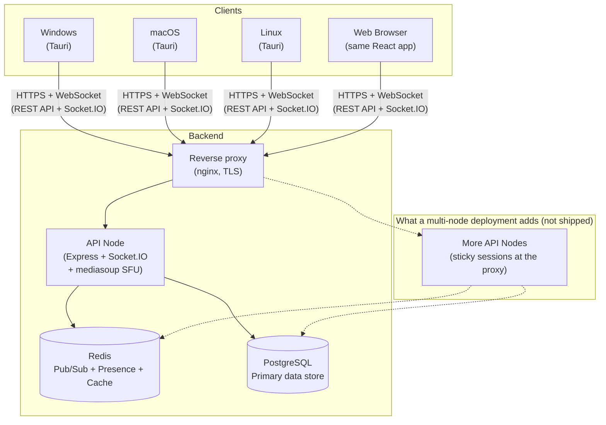

Solid lines are the topology the repository documents and production runs (one node behind a TLS reverse proxy; media goes from the clients straight to the node's mediasoup ports, not through the proxy). Dotted lines are what a multi-node deployment would add; see Scalability Strategy, Phase 2.

---

## Technology Stack

### Backend
| Layer | Technology | Version |
|-------|-----------|---------|
| Runtime | Node.js | 20+ |
| Language | TypeScript | 5.6+ |
| HTTP Framework | Express.js | 5.x |
| WebSocket | Socket.IO | 4.8 |
| ORM | Prisma | 7.x (driver adapter pattern) |
| Database | PostgreSQL | 16 |
| DB Driver | @prisma/adapter-pg | 7.x |
| Cache / Pub/Sub | Redis (node-redis) | 5.x |
| Voice (SFU) | mediasoup | 3.x |
| Auth | JWT (jsonwebtoken) | 9.x |
| Rate Limiting | rate-limiter-flexible | 10.x |
| Password Hashing | bcryptjs | 3.x |
| File Storage | S3-compatible object storage | — |
| S3 Presigning | @aws-sdk/s3-request-presigner | — |
| Email | Nodemailer | 9.x |

### Frontend
| Layer | Technology | Version |
|-------|-----------|---------|
| Framework | React | 19 |
| Language | TypeScript | 5.6+ |
| Build Tool | Vite | 8.x |
| Desktop Shell | Tauri | 2.x |
| Styling | Tailwind CSS | 4.x (CSS-first `@theme` config) |
| State | Zustand | 5.x |
| Routing | React Router | 7.x |
| HTTP Client | Axios | 1.x |
| WebSocket Client | socket.io-client | 4.8 |
| WebRTC | Native RTCPeerConnection | — |
| Icons | Lucide React | — |

### Infrastructure
| Component | Technology |
|-----------|-----------|
| Containers | Docker + Docker Compose |
| Orchestration (future) | Kubernetes |
| CI/CD | GitHub Actions (lint, typecheck, build, release, Docker) |
| Monitoring (future) | Prometheus + Grafana |

---

## Backend Architecture

### Directory Structure

```
apps/server/
├── prisma/
│   ├── schema.prisma       # Database schema
│   └── seed.ts             # Demo data seeder
├── src/
│   ├── index.ts            # Entry point, server bootstrap
│   ├── app.ts              # Express app configuration, middleware, routes
│   ├── routes/
│   │   ├── auth.ts         # Register, login, refresh, me, forgot/reset/change password
│   │   ├── servers.ts      # CRUD servers, join/leave, settings, members (online People slice, signed-keyset directory, batched lookup), member search
│   │   ├── secureChannels.ts # Invite-only E2E channels: create, rename, members, moderation count
│   │   ├── e2e.ts          # E2E device keys, key shares, master-key transfers, backup, message keys
│   │   ├── discovery.ts    # Space discovery (Explore): directory, join requests
│   │   ├── webhooks.ts     # Incoming-webhook management (servers/:serverId/webhooks)
│   │   ├── webhookExecute.ts # Public webhook execute route, mounted outside the api router
│   │   ├── channels.ts     # CRUD channels, mark-as-read, bulk reorder
│   │   ├── categories.ts   # CRUD categories, bulk reorder
│   │   ├── messages.ts     # CRUD messages with pagination, reactions, @mention resolution
│   │   ├── dm.ts           # DM conversations, messages, reactions, read tracking, deletion
│   │   ├── users.ts        # User profiles, profile update with real-time broadcast
│   │   ├── invites.ts      # Create/use/preview invites
│   │   ├── uploads.ts      # Presigned URL generation (S3) + proxy streaming for attachments + GET redirect for public assets
│   │   ├── friends.ts      # Friend requests (send/accept/decline/remove), friendship status
│   │   ├── search.ts       # Full-text message search (server channels + DM conversations)
│   │   ├── reports.ts      # User-facing report submission
│   │   ├── support.ts      # User-facing support ticket routes
│   │   ├── roles.ts        # Role CRUD, member role assignment, channel permission overrides
│   │   ├── themes.ts       # Community theme marketplace (CRUD, publish/unpublish, install/uninstall, admin moderation)
│   │   ├── admin.ts        # Admin API (users, servers, bans, storage, reports, support, rate limits, feature flags, audit log, export)
│   │   └── stats.ts        # Public stats endpoint
│   ├── services/
│   │   ├── authService.ts  # Auth business logic
│   │   └── totpService.ts  # TOTP 2FA (encrypted secrets, backup codes, replay protection)
│   ├── middleware/
│   │   ├── auth.ts         # JWT authentication middleware
│   │   ├── rateLimiter.ts  # Per-endpoint + per-socket rate limiting (Redis-backed registry, admin-editable)
│   │   ├── requireSuperAdmin.ts # Admin/superadmin role guards
│   │   ├── requireFeature.ts # Feature-flag kill switch (403 when a flag is off)
│   │   └── errorHandler.ts # Global error handler
│   ├── websocket/
│   │   ├── socketServer.ts  # Socket.IO setup, connection handler
│   │   ├── voiceHandler.ts  # Voice channel state management
│   │   ├── voiceRelay.ts    # Cross-node voice event relay (shim sockets)
│   │   ├── voiceCluster.ts  # Channel ownership, takeover, eviction fan-out
│   │   ├── annotationHandler.ts # Screen-share annotations (ops/live planes)
│   │   ├── dmVoiceHandler.ts # DM call signaling + system messages
│   │   └── adminMetrics.ts  # Live metrics emitter for admin dashboard
│   ├── mediasoup/
│   │   ├── mediasoupManager.ts # Workers, routers, WebRtcServer per worker, transports
│   │   └── mediasoupConfig.ts  # Codecs, bitrates, port range
│   └── utils/
│       ├── prisma.ts            # Prisma client singleton (v7 adapter pattern via @prisma/adapter-pg)
│       ├── redis.ts             # Redis client + presence helpers
│       ├── errors.ts            # Custom error classes
│       ├── sanitize.ts          # HTML stripping + text sanitization utility
│       ├── s3.ts                # S3 client + presigned URL generation + delete helper + getS3Object proxy + VALID_S3_KEY_RE
│       ├── email.ts             # Nodemailer transporter + password reset email + cleanup report email
│       ├── attachmentCleanup.ts # Scheduled job (daily 4 AM) — expires attachments older than retention period, deletes from S3, emails report
│       ├── orphanCleanup.ts    # Scheduled job (daily 5 AM) — deletes S3 objects nothing references, age-gated (7d) and leader-locked; backstop for delete paths that miss a blob
│       ├── registrationHygiene.ts # Scheduled job (daily 4:30 AM) — deletes unverified accounts past the 7d TTL + IpRecords past 180d; leader-locked, records each run for the admin panel
│       ├── reactions.ts         # Shared reaction aggregation (channels + DMs)
│       ├── mentions.ts          # @mention extraction, resolution, batch resolution (server members only)
│       ├── memberBroadcast.ts   # Server room join + member event broadcast
│       ├── auditLog.ts         # Fire-and-forget audit event logger
│       ├── featureFlags.ts     # Redis-backed feature flag registry
│       ├── permissionCalculator.ts # Server/channel permission bitmask calculation
│       ├── channelVisibilityRooms.ts # Re-syncs channel:{id} rooms after a VIEW_CHANNEL change
│       ├── serverJoin.ts       # joinServerMember(): ban check, limits, memberCount, room join
│       ├── removeMember.ts     # removeMemberFromServer(): leave/kick (a kick is a ban)
│       ├── messageAuthor.ts    # shapeMessageRow(): author shape incl. webhook rows
│       ├── presenceReaper.ts   # 60 s ghost-presence reconciliation under a cluster lock
│       ├── dailySchedule.ts    # withClusterLock() slot scheduling for nightly jobs
│       ├── accountDeletion.ts  # deleteUserAccount(): the one account-deletion sequence
│       ├── redactUrl.ts / trustProxy.ts # Credential-in-URL log redaction; trusted-proxy hop parsing
│       └── webhooks/           # Webhook payload formatters (generic, GitHub)
```

### Request Flow

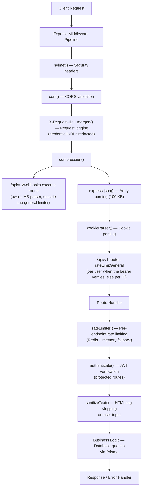

### Error Handling

Custom error classes provide structured HTTP error responses:

```typescript
AppError (base)
├── BadRequestError     (400)
├── UnauthorizedError   (401)
├── ForbiddenError      (403)
├── NotFoundError       (404)
├── ConflictError       (409)
├── UnsupportedMediaTypeError (415)
├── TooManyRequestsError      (429)
└── ServiceUnavailableError   (503)
```

Body-parser failures (an oversized body → 413 `Request body too large`, malformed JSON → 400 `Malformed JSON body`) and a malformed percent-escape in the URL (400 `Malformed URL`) answer in the same `{ success: false, error }` shape with a fixed sentence, never the parser's message, and log a redacted path without a stack. All other unhandled errors return a generic 500 response without leaking internals.

---

## Frontend Architecture

### Directory Structure

```
apps/desktop/
├── src/
│   ├── main.tsx              # React entry point
│   ├── App.tsx               # Root component with routing
│   ├── pages/
│   │   ├── LoginPage.tsx          # Login form + forgot password link + peeking thief
│   │   ├── RegisterPage.tsx       # Registration form + peeking thief
│   │   ├── ForgotPasswordPage.tsx # Email input → sends reset link
│   │   ├── ResetPasswordPage.tsx  # Token-based new password form
│   │   └── InvitePage.tsx         # Invite preview + join
│   ├── components/
│   │   ├── layout/
│   │   │   ├── MainLayout.tsx    # Shell: spaces strip on top, then sidebar column + chat panel + People panel
│   │   │   ├── TitleBar.tsx      # Custom window chrome (minimize/maximize/close, drag region; the Tauri window has no native decorations)
│   │   │   ├── UserCard.tsx      # Current user card (bottom of the sidebar column)
│   │   │   ├── ConnectionBanner.tsx / AnnouncementBanner.tsx / ErrorBoundary.tsx
│   │   │   └── ToastContainer.tsx # Fixed-position toast notification overlay
│   │   ├── auth/
│   │   │   ├── AuthBackground.tsx     # Animated auth page background
│   │   │   └── PeekingThief.tsx       # SVG thief character (reacts to password typing)
│   │   ├── server/
│   │   │   ├── SpacesStrip.tsx        # Spaces strip along the top: Messages tab + 3 recent people | space tabs, +N, dashed "New space" tab, Find a space, Explore; pinned (default) or auto-hide notch (settingsStore.spacesStripMode)
│   │   │   ├── ServerSwitcher.tsx     # "Find a space" menu: Live now / Pinned / All spaces, type to jump
│   │   │   ├── CreateServerModal.tsx  # Create or join a space, with icon upload
│   │   │   ├── ServerSettingsModal.tsx # Space settings (permission-gated tabs, incl. integrations and discovery)
│   │   │   ├── SecureChannelCreateModal.tsx  # Create a secure channel (member picker)
│   │   │   ├── SecureChannelMembersModal.tsx # Secure-channel membership; lists the directory via useMemberDirectory
│   │   │   ├── MemberDirectoryFooter.tsx     # Next-page sentinel/button for directory pickers
│   │   │   └── MemberSidebar.tsx      # People panel (far right, 272 px)
│   │   ├── channel/
│   │   │   └── ChannelSidebar.tsx # Channel list (sidebar column): category headings (category-label) over a rail of their channels, always-visible secure-channel and create-category controls
│   │   ├── common/
│   │   │   ├── Avatar.tsx           # Shared avatar with img/initials fallback
│   │   │   ├── EmojiPicker.tsx      # Portal-based emoji picker (shared)
│   │   │   ├── UserHoverTarget.tsx  # Hover wrapper → UserProfilePopup
│   │   │   └── UserProfilePopup.tsx # User profile card (server members + API fallback for DMs)
│   │   ├── chat/
│   │   │   ├── ChatArea.tsx         # Server chat container
│   │   │   ├── MessageList.tsx      # Scrollable message list
│   │   │   ├── MessageItem.tsx      # Single message with edit/delete/reactions/mention highlight
│   │   │   ├── MessageContent.tsx   # Mention-aware content rendering (text + @mention badges)
│   │   │   ├── MentionAutocomplete.tsx # @mention autocomplete (server-side search, keyboard nav)
│   │   │   ├── MessageInput.tsx     # Message composer (channels + DMs)
│   │   │   ├── ReactionDisplay.tsx  # Reaction chips (channels + DMs)
│   │   │   └── DeleteConfirmModal.tsx # Message delete confirmation
│   │   ├── dm/
│   │   │   ├── DMList.tsx           # Conversation list with unread badges
│   │   │   ├── DMChatArea.tsx       # DM chat view + call UI
│   │   │   ├── DMMessageList.tsx    # DM scrollable messages with system msgs
│   │   │   ├── DMCallPanel.tsx      # Discord-style call UI (avatars, controls)
│   │   │   └── IncomingCallModal.tsx # Incoming call accept/decline + looping ringtone
│   │   ├── friends/
│   │   │   ├── FriendsView.tsx     # Tabbed friends interface (Online/All/Pending/Add)
│   │   │   ├── FriendListItem.tsx  # Friend row with action buttons
│   │   │   └── AddFriendForm.tsx   # Send friend request by username
│   │   ├── voice/
│   │   │   ├── VoicePanel.tsx          # Server voice connection controls
│   │   │   ├── DMVoicePanel.tsx        # Global DM call status (visible from any view)
│   │   │   ├── ScreenShareViewer.tsx   # Inline screen share viewer (replaces ChatArea)
│   │   │   └── ScreenShareFloating.tsx # Draggable/resizable floating viewer
│   │   └── search/
│   │       ├── SearchField.tsx      # Search field in each chat header (space channel / DM); opens SearchModal
│   │       └── SearchModal.tsx      # Full-text message search (space + DM); Ctrl/Cmd+K opens it from anywhere
│   ├── stores/
│   │   ├── authStore.ts      # Auth state (user, tokens)
│   │   ├── serverStore.ts    # Server/channel state
│   │   ├── chatStore.ts      # Messages and typing (channels + DMs)
│   │   ├── voiceStore.ts     # Voice connection state (server + DM calls)
│   │   ├── dmStore.ts        # DM conversations, unread tracking, deletion
│   │   ├── friendStore.ts    # Friends list, friend requests, real-time events
│   │   ├── settingsStore.ts  # Audio devices, notifications, PTT, theme, spacesStripMode (localStorage)
│   │   ├── discoveryStore.ts # Explore directory, join requests (reconciled against serverStore)
│   │   ├── e2eStore.ts       # E2E state
│   │   ├── supportStore.ts / announcementStore.ts # Support tickets, admin announcements
│   │   ├── annotationStore.ts / annotationLiveStore.ts / maskLayoutStore.ts # Screen-share annotations, live ink, privacy-mask layouts
│   │   ├── resetStores.ts    # ACCOUNT_STORES list wiped on logout
│   │   └── toastStore.ts     # Toast notification queue + convenience helpers
│   ├── services/
│   │   ├── api.ts               # Axios instance with interceptors
│   │   ├── socket.ts            # Socket.IO client manager
│   │   ├── audioAnalyser.ts     # Speaking detection (server + DM mode)
│   │   ├── notificationSounds.ts # Sound effects (message, mention, join, leave, looping call ringtone)
│   │   ├── tokenStorage.ts      # Session store: memory + write-through (OS credential store in the Tauri app, localStorage/sessionStorage on the web)
│   │   └── notifications.ts     # 3-tier notifications: WinRT toast (avatar) → Tauri plugin → Web API (blob URL avatar)
│   ├── hooks/
│   │   ├── useMemberDirectory.ts # Paged member directory for pickers (GET /servers/:id/members by cursor, q server-side, 100 a page)
│   │   ├── useMember.ts / useMemberSearch.ts / useServerPermissions.ts # Member lookup, mention search, permission checks
│   │   └── usePushToTalk.ts, useConnectionStatus.ts, ...
│   ├── utils/
│   │   ├── platform.ts          # isMacPlatform() (⌘ vs Ctrl in shortcut labels)
│   │   ├── imageProcessing.ts   # Client-side image resize + WebP via Canvas API
│   │   └── serverErrors.ts    # Server error message → i18n key mapping for translated error display
│   ├── i18n/
│   │   ├── index.ts           # i18next setup (browser detection, localStorage persistence)
│   │   └── locales/           # 11 language JSON files (en, fr, es, pt, de, ru, uk, ko, zh, ja, ar)
│   └── styles/
│       ├── globals.css        # Tailwind + custom utilities
│       └── themes.css         # Built-in theme definitions (dark, light, midnight, tactical)
├── src-tauri/                # Tauri Rust backend
│   ├── src/
│   │   ├── main.rs           # Desktop entry point
│   │   └── lib.rs            # Tauri setup + notify_with_avatar (WinRT toast with circular avatar) + e2e_pickle_key_* and session_secret_* (OS credential store) + graceful tray (Linux)
│   ├── Cargo.toml
│   └── tauri.conf.json       # Two undecorated windows: splash (360x240) and main (1280x800, min 940x560; React TitleBar is its chrome), CSP
```

### UI Layout

```
+----------------------------------------------------------------------+
| Messages (+3 recent) | [Space][Space] +N [+ New space]  Find Explore |  64px spaces strip
+------------+---------------------------------------+-----------------+
| [logo] Voxium | # channel-name              [Search] | People          |
|------------+---------------------------------------+                 |
| CATEGORY   | [Avatar] Username          12:30      | - Owner         |
| | # general| Message content here...               |   Alice         |
| | # random |                                       |                 |
| VOICE      | [Avatar] Username          12:31      | - Members       |
| | General  | Another message...                    |   Bob           |
|------------|                                       |                 |
| User  [G]  | [Message input box]                   |                 |
+------------+---------------------------------------+-----------------+
|   248px    |                flex-1                 |      272px      |
```

The strip is pinned (default) or, with Appearance > auto-hide, folds into a 132x12 notch under the title bar and slides out as a chamfered panel on hover, focus, Ctrl/Cmd+Shift+L or tap.

**DM View** (when no space is active; the same strip sits on top, with the Messages tab selected):

```
+----------------------------------------------------------+
| Messages (+3 recent) | [Space][Space] ...                 |  64px spaces strip
+------------+---------------------------------------------+
| [logo] Voxium | @ Username      [Search] [P] [V]          |
|------------+---------------------------------------------+
| * Alice    | [Avatar] Alice      12:30                    |
|  Last msg  | Hey, how are you?                           |
| o Bob      |                                             |
|  Hi!       | [Avatar] You        12:31                    |
|            | I'm good, thanks!                           |
| User  [G]  | [Message input box]                         |
+------------+---------------------------------------------+
|   248px    |                  flex-1                     |
```

### State Management (Zustand)

Fifteen independent stores, each managing a domain (the eight core ones below; `discoveryStore`, `e2eStore`, `supportStore`, `announcementStore`, `annotationStore`, `annotationLiveStore` and `maskLayoutStore` follow the same pattern, and `resetStores.ts` wipes every account-scoped one on logout):

| Store | Responsibilities |
|-------|-----------------|
| `authStore` | User session, login/register/logout, token management, avatar upload (presigned URL + client-side processing), profile editing, forgot/reset/change password |
| `serverStore` | Server list, active server, channels, members, server icon upload, member profile sync, persistent unread tracking (via `ChannelRead` DB table + `unread:init` socket event) |
| `chatStore` | Messages for active channel/conversation, typing indicators, pagination, author profile sync, reply-to-message state (shared by server channels and DMs) |
| `voiceStore` | Server voice channel connection, DM call state (`dmCallConversationId`, `dmCallUsers`, `incomingCall`), mute/deaf, `pttActive` (PTT override), peer management (WebRTC), noise suppression pipeline lifecycle. Server and DM voice are mutually exclusive. |
| `dmStore` | DM conversation list, active conversation, participant online/offline status, DM unread counts (persisted via `ConversationRead` + `dm:unread:init`), conversation deletion. Owns `clearMessages()` calls for DM view transitions. |
| `friendStore` | Friends list (accepted/pending incoming/pending outgoing), friend request CRUD, real-time friend event handlers, friendship status lookups, `showFriendsView` toggle |
| `settingsStore` | Audio devices, noise gate, notification prefs, PTT key, theme, `spacesStripMode` (`'pinned'` default or `'auto'` notch, Appearance tab) (persisted to localStorage) |
| `toastStore` | Toast notification queue, auto-dismiss timers, convenience helpers |

### Data Flow

Reads update the store from the API response. For server-mutating routes (messages, channels, spaces, ...) the response only answers the caller: the store changes when the resulting Socket.IO event arrives, the single source of truth, which prevents duplicates. A few self-scoped responses (auth, profile) are merged directly.

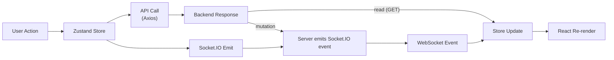

---

## Database Design

### Entity-Relationship Diagram

```mermaid
erDiagram
    User {
        string id PK
        string username UK
        string email UK
        string password
        string displayName
        string avatarUrl
        string bio
        string status
        int tokenVersion
        string resetToken UK
        boolean emailVerified
        string emailVerificationToken UK
        string totpSecret
        boolean totpEnabled
        string totpBackupCodes
        string role
        datetime bannedAt
    }

    Server {
        string id PK
        string name
        string ownerId FK
        string iconUrl
        boolean invitesLocked
        string description
        string tags
        boolean discoverable
        string joinMode
        datetime featuredAt
        datetime discoveryBlockedAt
        boolean discoveryListed
        int memberCount
        int onlineCount
        int weeklyMessages
        int activityScore
        datetime statsRefreshedAt
    }

    ServerMember {
        string userId PK
        string serverId PK
        string role
        string nickname
        datetime joinedAt
    }

    Channel {
        string id PK
        string name
        string type
        string serverId FK
        string categoryId FK
        int position
        boolean secure
        string createdById FK
    }

    ChannelMember {
        string channelId PK
        string userId PK
        boolean isCreator
        datetime addedAt
    }

    Category {
        string id PK
        string name
        string serverId FK
        int position
    }

    Message {
        string id PK
        string content
        string type
        string channelId FK
        string conversationId FK
        string authorId FK
        string webhookId FK
        string webhookName
        string replyToId FK
        datetime editedAt
        datetime createdAt
    }

    Webhook {
        string id PK
        string serverId FK
        string channelId FK
        string name
        string type
        string tokenHash
        string secretEnc
        boolean enabled
        string createdById FK
        datetime lastUsedAt
        datetime createdAt
        datetime updatedAt
    }

    MessageReaction {
        string id PK
        string messageId FK
        string userId FK
        string emoji
        datetime createdAt
    }

    Invite {
        string code PK
        string serverId FK
        string createdBy FK
        datetime expiresAt
    }

    ServerBan {
        string serverId PK
        string userId PK
        string bannedById FK
        string reason
        datetime createdAt
    }

    ServerJoinRequest {
        string id PK
        string serverId FK
        string userId FK
        string message
        string status
        string decidedById FK
        datetime decidedAt
        datetime createdAt
    }

    ChannelRead {
        string userId PK
        string channelId PK
        datetime lastReadAt
    }

    Conversation {
        string id PK
        string user1Id FK
        string user2Id FK
        datetime updatedAt
    }

    ConversationRead {
        string userId PK
        string conversationId PK
        datetime lastReadAt
    }

    GlobalConfig {
        string id PK
        int maxChannelsPerServer
        int maxVoiceUsersPerChannel
        int maxCategoriesPerServer
        int maxMembersPerServer
        int maxWebhooksPerServer
        datetime updatedAt
    }

    ServerLimits {
        string serverId PK
        int maxChannelsPerServer
        int maxVoiceUsersPerChannel
        int maxCategoriesPerServer
        int maxMembersPerServer
        int maxWebhooksPerServer
        datetime updatedAt
    }

    Role {
        string id PK
        string serverId FK
        string name
        string color
        int position
        string permissions
        boolean isDefault
    }

    MemberRole {
        string userId PK
        string serverId PK
        string roleId PK
    }

    ChannelPermissionOverride {
        string id PK
        string channelId FK
        string roleId FK
        string allow
        string deny
    }

    CommunityTheme {
        string id PK
        string name
        string description
        string tags
        json colors
        json patterns
        int version
        string status
        int installCount
        string authorId FK
    }

    InfraServer {
        string id PK
        string name
        string country
        string city
        string provider
        float latitude
        float longitude
    }

    MessageAttachment {
        string id PK
        string messageId FK
        string s3Key UK
        string fileName
        int fileSize
        string mimeType
        boolean expired
    }

    Friendship {
        string id PK
        string requesterId FK
        string addresseeId FK
        string status
        datetime createdAt
    }

    IpRecord {
        string id PK
        string userId FK
        string ip
        string countryCode
        string kind
        datetime lastSeenAt
    }

    IpBan {
        string id PK
        string ip UK
        string reason
        string bannedBy FK
        datetime createdAt
    }

    AuditLog {
        string id PK
        string actorId FK
        string action
        string targetType
        string targetId
        json metadata
        datetime createdAt
    }

    Announcement {
        string id PK
        string title
        string content
        string type
        string scope
        string serverIds
        string createdById FK
        datetime publishedAt
        datetime expiresAt
    }

    Report {
        string id PK
        string type
        string status
        string reason
        string reporterId FK
        string reportedUserId FK
        string messageId FK
        string contentSource
        string resolvedById FK
        datetime resolvedAt
    }

    SupportTicket {
        string id PK
        string userId FK
        string status
        string claimedById FK
        datetime claimedAt
        datetime closedAt
    }

    SupportMessage {
        string id PK
        string ticketId FK
        string authorId FK
        string content
        string type
        datetime createdAt
    }

    E2EDevice {
        string id PK
        string userId FK
        string deviceId
        string curve25519Key
        string ed25519Key
        string deviceSignature
        string masterSignature
    }

    E2EDeviceRegistry {
        string userId PK
        int version
    }

    E2EKeyBackup {
        string id PK
        string userId FK
        string blob
        datetime updatedAt
    }

    E2EMessageKeyBackup {
        string id PK
        string userId FK
        string conversationId
        string sessionId
        string blob
        int firstKnownIndex
    }

    E2EKeyShare {
        string id PK
        string recipientUserId
        string recipientDeviceId
        string senderUserId
        string conversationId
        string sessionId
        string body
    }

    E2EMasterKey {
        string userId PK
        string publicKey
        string signature
        datetime updatedAt
    }

    E2EMasterTransfer {
        string id PK
        string userId
        string recipientDeviceId
        string senderDeviceId
        string body
        datetime createdAt
    }

    E2EOneTimeKey {
        string id PK
        string deviceId FK
        string keyId
        string publicKey
        string signature
        datetime createdAt
    }

    User ||--o{ ServerMember : "has many"
    Server ||--o{ ServerMember : "has many"
    Server ||--o{ Channel : "has many"
    Server ||--o{ Category : "has many"
    Category ||--o{ Channel : "has many"
    Channel ||--o{ Message : "has many"
    Conversation ||--o{ Message : "has many"
    User ||--o{ Message : "authors"
    Server ||--o{ Webhook : "has many"
    Channel ||--o{ Webhook : "has many"
    User ||--o{ Webhook : "creates"
    Webhook ||--o{ Message : "posts"
    Message ||--o{ MessageReaction : "has many"
    Message ||--o| Message : "replyTo"
    User ||--o{ MessageReaction : "has many"
    Server ||--o{ Invite : "has many"
    User ||--o{ Invite : "creates"
    Server ||--o{ ServerBan : "bans"
    User ||--o{ ServerBan : "banned from"
    Server ||--o{ ServerJoinRequest : "receives"
    User ||--o{ ServerJoinRequest : "sends"
    User ||--o{ ChannelRead : "has many"
    Channel ||--o{ ChannelRead : "has many"
    User ||--o{ Conversation : "user1"
    User ||--o{ Conversation : "user2"
    User ||--o{ ConversationRead : "has many"
    Conversation ||--o{ ConversationRead : "has many"
    Server ||--o| ServerLimits : "has one"
    Server ||--o{ Role : "has many"
    Role ||--o{ MemberRole : "has many"
    ServerMember ||--o{ MemberRole : "has many"
    Channel ||--o{ ChannelPermissionOverride : "has many"
    Role ||--o{ ChannelPermissionOverride : "has many"
    User ||--o{ CommunityTheme : "authors"
    Channel ||--o{ ChannelMember : "secure members"
    User ||--o{ ChannelMember : "has many"
    Message ||--o{ MessageAttachment : "has many"
    User ||--o{ Friendship : "requests"
    User ||--o{ Friendship : "receives"
    User ||--o{ IpRecord : "seen at"
    User ||--o{ IpBan : "creates"
    User ||--o{ AuditLog : "acts in"
    User ||--o{ Announcement : "creates"
    User ||--o{ Report : "files"
    User ||--o{ Report : "reported in"
    User ||--o{ Report : "resolves"
    Message ||--o{ Report : "subject of"
    User ||--o| SupportTicket : "opens"
    User ||--o{ SupportTicket : "claims"
    SupportTicket ||--o{ SupportMessage : "has many"
    User ||--o{ SupportMessage : "writes"
    User ||--o{ E2EDevice : "owns"
    E2EDevice ||--o{ E2EOneTimeKey : "has many"
    User ||--o| E2EKeyBackup : "has one"
    User ||--o{ E2EMessageKeyBackup : "has many"
```

Not every table is drawn as a relation. `InfraServer` (the hosting locations an admin lists under `/admin/infra-servers`) stands alone. Four E2E tables (`E2EDeviceRegistry`, `E2EMasterKey`, `E2EKeyShare`, `E2EMasterTransfer`) hold user and device ids by value, with no foreign key: `purgeE2EMaterial()` (`utils/e2ePurge.ts`) deletes them explicitly when an account goes, and only ciphertext, public keys and sealed envelopes ever reach any of the E2E tables. `Report` likewise carries `channelId`, `conversationId` and `serverId` as plain ids, and keeps a copy of the reported text (`messageContent`).

### Key Indexes

- `messages(channelId, createdAt)` — Fast message pagination per channel
- `messages(conversationId, createdAt)` — Fast message pagination per DM conversation
- `messages(webhookId)` — the `ON DELETE SET NULL` action of a webhook delete and the delete-with-purge find a webhook's rows through it (PostgreSQL does not index FK columns); `webhooks(serverId)`, `webhooks(channelId)` — the Integrations list and the cascades
- `message_reactions(messageId)` — Reaction aggregation per message
- `message_reactions(messageId, userId, emoji)` UNIQUE — One reaction per user per emoji
- `users(username)` UNIQUE — Username lookup
- `users(email)` UNIQUE — Email lookup
- `users(reset_token)` UNIQUE — Password reset token lookup
- `users(email_verification_token)` UNIQUE — Email verification token lookup
- `server_members(userId, serverId)` COMPOSITE PK — Membership checks; `server_members(serverId)` — member lists per server
- `channel_members(channelId, userId)` COMPOSITE PK, `channel_members(userId)` — Secure channel membership (the only access path to a secure channel)
- `messages USING GIN (content gin_trgm_ops)` — substring message search
- `users(email_canonical)` UNIQUE — Email dedupe across aliases
- `channel_reads(userId, channelId)` COMPOSITE PK — Read position lookups
- `conversations(user1Id, user2Id)` UNIQUE — Conversation dedup
- `conversation_reads(userId, conversationId)` COMPOSITE PK — DM read positions
- `invites(code)` PK — Invite lookup
- `servers(discovery_listed, discovery_activity_score DESC, id DESC)` and one more per directory sort (`member_count`, `created_at`, `name`) — every Explore page is a single index range scan under a keyset cursor
- `servers(discovery_listed, discovery_stats_at)` — the stats cycle picks the stalest listed servers first
- `servers(featured_at)` — the Featured row
- `servers USING GIN (tags)` — tag filter; `servers USING GIN (name gin_trgm_ops)` — substring name search
- `server_bans(server_id, user_id)` COMPOSITE PK — the ban check on every join path; `server_bans(user_id)`
- `server_join_requests(server_id, user_id)` UNIQUE — one request per user per server; `(server_id, status)`, `(status, created_at)`, `(status, decided_at)` — moderator lists and the two sweeps
- `roles(serverId, position)` — Role hierarchy ordering
- `roles(serverId, name)` UNIQUE — Role name uniqueness per server
- `channel_permission_overrides(channelId, roleId)` UNIQUE — One override per role per channel
- `community_themes(status, installCount)` — Marketplace sort by popularity
- `community_themes(status, createdAt)` — Marketplace sort by newest
- `community_themes(authorId)` — User's own themes

### Scaling Considerations

- Messages use cursor-based pagination (`createdAt < ?`) instead of offset-based for consistent performance
- The `ServerMember` junction table allows efficient membership queries in both directions
- Channel positions are integer-based for simple reordering
- Unread counts computed via a single raw SQL query on connect, leveraging the existing `messages(channelId, createdAt)` index. `ChannelRead` table stores per-user read positions for persistence across sessions.

---

## Real-Time Communication

### Socket.IO Architecture

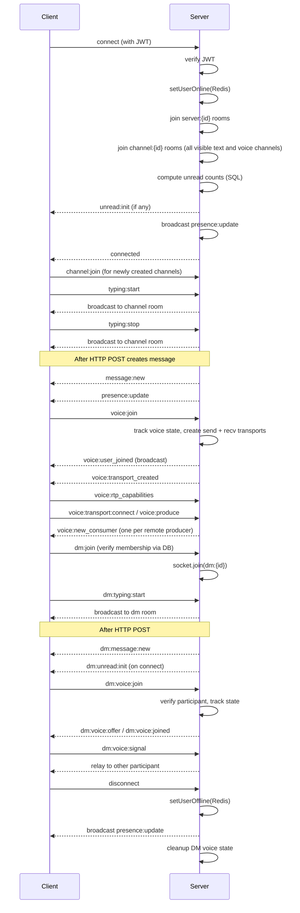

### Room Strategy

| Room Pattern | Purpose | When Joined |
|-------------|---------|-------------|
| `server:{id}` | Server-wide events (member join/leave, presence, space/channel/role/webhook changes). Voice presence is NOT sent here; it goes to `channel:{id}` | On socket connect (all memberships) + dynamically on server create/join via `memberBroadcast.ts` |
| `channel:{id}` | The VIEW_CHANNEL boundary: messages, typing, voice presence and screen share events for text and voice channels | Auto-joined on socket connect for every text and voice channel the user can view (not only channels they are a member of). Client also emits `channel:join` when selecting a channel (needed for channels created after connect); the server re-checks VIEW_CHANNEL. Permission changes re-sync the rooms via `syncChannelVisibilityRooms()`. **Never left** — the socket stays subscribed for the connection's lifetime so `message:new` events reach the client for unread tracking. |
| `voice:{id}` | Voice channel (voice state, signaling) | Client emits `voice:join` when joining voice |
| `dm:{id}` | DM messages, typing, reactions | Auto-joined on socket connect for all conversations; `dm:join` emitted for new conversations. Authorization verified via DB query before joining. |
| `dm:voice:{id}` | DM call signaling | Joined on `dm:voice:join`, left on call end |
| `user:{id}` | Every socket of one user: targeted events (join approvals, secure channel membership), moderator fan-out, `socketsJoin`/`socketsLeave` by user | On socket connect |
| `support:{id}` | A support ticket thread (requester and claiming admin) | Joined via their `user:{id}` room when the ticket is opened or claimed, and on connect while the ticket is open or claimed |
| `admin:support` | The support queue for platform staff: `support:ticket:new`, `support:message:new` and `support:status_change`, emitted by `routes/support.ts` (a user opens a ticket or writes) and `routes/admin.ts` (an admin claims, replies or closes). Sibling rooms `admin:reports` (`report:new`) and `admin:metrics` (the live dashboard snapshot) work the same way | On the `admin:subscribe_support` socket event, accepted only when the socket's platform role is `admin` or `superadmin`; left on `admin:unsubscribe_support` or disconnect |

**Critical invariants:**
- Every code path that makes a user a server member (create, join, invite) must also add their socket(s) to the `server:{id}` room and seed `ChannelRead` records for all text channels (`lastReadAt = now()`), excluding `secure: true` channels: a secure text channel seeds its own members' rows when it is created or a member is added (`routes/secureChannels.ts`), so a user who was never invited has none. Failure to join the room breaks all server-scoped real-time features; missing ChannelRead records cause existing message history to show as unread.
- `channel:leave` must NOT be emitted by the client — it undoes the server's auto-subscription, breaking `message:new` delivery for that channel. Since the socket stays in all channel rooms, typing events are filtered by `channelId` on the frontend.
- `dm:join` must verify conversation membership via DB query before adding the socket to the room — prevents eavesdropping. `dm:typing` handlers must check `socket.rooms.has()` to prevent unauthorized emission.
- DM voice event handlers on the frontend must guard by `conversationId === dmCallConversationId` — the socket receives events for ALL conversations it's subscribed to, so unguarded handlers would leak voice events from other conversations into the active call state.
- Server voice and DM voice are mutually exclusive: `voice:join` on server triggers `leaveCurrentDMVoiceChannel()`, and `dm:voice:join` triggers `leaveCurrentVoiceChannel()`. Both server and client enforce this.

### Event Types

**Server → Client:**
- `message:new` / `message:update` / `message:delete` / `message:reaction_update`
- `message:bulk_deleted` (`{ channelId, webhookId, count }` to `channel:{id}`: a webhook deleted with its messages)
- `webhook:changed` (`{ serverId }` only, to `server:{id}`: an open Integrations tab refetches)
- `channel:created` / `channel:deleted`
- `member:joined` / `member:left`
- `presence:update`
- `voice:user_joined` / `voice:user_left` / `voice:state_update` / `voice:speaking`
- `voice:transport_created` / `voice:new_consumer` / `voice:producer_closed` (mediasoup SFU negotiation)
- `voice:screen_share:start` / `voice:screen_share:stop` / `voice:screen_share:state`
- `typing:start` / `typing:stop`
- `server:updated` (server name/icon changed)
- `user:updated` (user displayName/avatar changed)
- `unread:init` (persistent unread counts on connect/reconnect)
- `dm:message:new` / `dm:message:update` / `dm:message:delete` / `dm:message:reaction_update`
- `dm:typing:start` / `dm:typing:stop`
- `dm:unread:init` (persistent DM unread counts)
- `dm:voice:offer` / `dm:voice:joined` / `dm:voice:left` / `dm:voice:ended`
- `voice:channel_users` (occupancy replay on connect and join) / `voice:error` / `voice:force_moved` / `voice:e2e:key` / `voice:e2e:key_request`
- `voice:annotation:state` / `voice:annotation:ops` / `voice:annotation:live`
- `channel:members_updated` (secure channel membership)
- `role:created` / `role:updated` / `role:deleted` / `role:reordered` / `member:roles_updated` / `member:nickname_updated` / `channel:permissions_updated`
- `theme:published` / `theme:updated` / `theme:removed`
- `dm:voice:state_update` / `dm:voice:speaking` / `dm:voice:signal`
- `dm:conversation:deleted`
- `friend:request_received` / `friend:request_accepted` / `friend:removed`
- `member:role_updated` / `member:kicked`
- `server:deleted`
- `server:join_request` / `server:join_request_resolved` (the moderator audience only: `user:{id}` rooms of KICK_MEMBERS / ADMINISTRATOR holders and the owner, never `server:{id}`)
- `server:join_approved` / `server:join_declined` (the requester's `user:{id}` room)
- `category:created` / `category:updated` / `category:deleted`
- `channel:updated`

**Client → Server:**
- `channel:join` (for newly created channels only; `channel:leave` is NOT used — auto-subscription persists)
- `voice:join` / `voice:leave` / `voice:mute` / `voice:deaf` / `voice:speaking`
- `voice:screen_share:start` / `voice:screen_share:stop`
- `typing:start` / `typing:stop`
- `dm:join` (join DM room for new conversation, with authorization check)
- `dm:typing:start` / `dm:typing:stop`
- `dm:voice:join` / `dm:voice:leave` / `dm:voice:mute` / `dm:voice:deaf` / `dm:voice:speaking`
- `dm:voice:signal` (E2E-sealed signaling relay for DM calls) / `dm:voice:decline`
- `voice:rtp_capabilities` / `voice:transport:connect` / `voice:produce` / `voice:consumer:resume` / `voice:producer:close` / `voice:e2e:key` (mediasoup SFU negotiation)

---

## Voice Architecture

### Current Implementation — mediasoup SFU

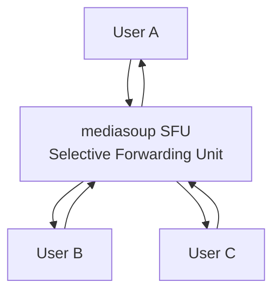

- Each client sends one upstream (Producer) to the SFU
- SFU selectively forwards streams to recipients via Consumers
- Each voice channel gets its own mediasoup Router (lazy-created, round-robin across Workers)
- Each user gets 2 WebRTC transports (send + recv), multiplexed on their worker's single WebRtcServer port (UDP + TCP, `MEDIASOUP_MIN_PORT` + worker slot); `MEDIASOUP_WEBRTC_SERVER=false` falls back to one port per transport
- Workers: 1 per CPU core (capped at 8), auto-restart on death
- Configuration: `MEDIASOUP_LISTEN_IP`, `MEDIASOUP_ANNOUNCED_IP` (LAN IP), `MEDIASOUP_MIN_PORT`/`MAX_PORT`
- Key files: `mediasoup/mediasoupManager.ts`, `mediasoup/mediasoupConfig.ts`, `websocket/voiceHandler.ts`

### Voice State Management

Voice state is tracked per-channel in memory:

```typescript
// Voice user state (includes mediasoup transports/producers/consumers)
Map<channelId, Map<userId, {
  socketId: string;
  selfMute: boolean;
  selfDeaf: boolean;
  sendTransport: WebRtcTransport | null;
  recvTransport: WebRtcTransport | null;
  producers: Map<string, Producer>;
  consumers: Map<string, Consumer>;
  rtpCapabilities: RtpCapabilities | null;
}>>

// Screen share state (one sharer per channel)
Map<channelId, userId>  // screenSharers
```

For multi-node deployment the channel's owner node runs every voice event (`voice:channel:node:{id}`); remote sockets are relayed as shims and cross-node state (occupancy, screen-share mirror, annotation scenes) lives in Redis. See Phase 2: Multi-Node.

### Resource Limits

Server resource limits are enforced dynamically via `utils/serverLimits.ts`:
- **Resolution order:** per-server override (`ServerLimits` table) > global config (`GlobalConfig` singleton) > hardcoded `LIMITS` constants
- **Defaults:** maxChannelsPerServer=20, maxVoiceUsersPerChannel=12, maxCategoriesPerServer=12, maxMembersPerServer=0 (unlimited), maxWebhooksPerServer=10 (0 stops creation)
- **Enforcement points:** channel creation, category creation, voice:join, invite join, webhook creation (the create route in `routes/webhooks.ts`)
- **Admin API:** `GET/PUT /admin/limits/global`, `GET/PUT/DELETE /admin/limits/servers/:serverId`
- **User API:** `GET /servers/:serverId/limits` (read-only, shown in ServerSettingsModal "Limits" tab)

### Screen Sharing

Screen sharing allows one user per voice channel to share their screen with all other participants using `getDisplayMedia` for capture:

- **Capture:** Browser/WebView2 native `getDisplayMedia()` API (hardware-accelerated, supports video + optional system audio)
- **Transport:** Video track produced as a mediasoup Producer with server-derived `appData: { type: 'screen-video' }` (system audio: `screen-audio`), consumed by all other channel users. The server never trusts client appData — a non-sharer's claimed screen producer is rejected/downgraded.
- **One sharer per channel:** Server enforces via `screenSharers` Map (mirrored to Redis `voice:screen:{channelId}`); a second start request is ACKed `{ ok: false, error: 'Someone else is already sharing in this channel' }`
- **Late-joiner hydration:** `voice:join` handler emits `voice:screen_share:state` (and `voice:annotation:state` when a scene exists) so users joining mid-share see the stream and its annotations immediately
- **Viewer modes:** Inline (replaces ChatArea) or floating (draggable/resizable portal)
- **Cleanup:** Automatic stop on voice leave, disconnect, server deletion, or browser stop button (`track.onended`)

### Screen-Share Annotations & Overlays

The active sharer can draw over the shared screen live (Twitch-style): pen/highlighter strokes, rectangle/ellipse highlights, text captions, and image overlays (logo/promo), plus **privacy masks** that truly hide screen regions. Two disjoint data planes:

- **Annotations (metadata plane):** vector ops in normalized [0..1] frame coordinates, batched every 150ms over `voice:annotation:ops`, broadcast to the `voice:{channelId}` room, and rendered by every viewer on a DPR-aware canvas mapped onto the video's object-contain content rect (`AnnotationCanvas`). The authoritative scene lives ONLY in Redis (`voice:annotations:{channelId}`, 4h TTL backstop) with a server-assigned `rev` counter for late-joiner snapshot ordering. Image overlays travel as size-capped webp data-URLs inside ops (session-only — no S3, no cleanup jobs). Caps in `packages/shared/src/constants.ts` (`ANNOTATION_*`); shared reducer in `packages/shared/src/annotations.ts`.
- **Privacy masks (video plane):** mask geometry NEVER touches the network. While ≥1 mask exists, the sharer's client composites raw frame + masks on a canvas (`services/screenComposite.ts`) and swaps the outgoing producer track via `producer.replaceTrack()` — covered pixels never leave the sharer's machine. The screen-video producer is created with `stopTracks: false, disableTrackOnPause: false, zeroRtpOnPause: true` and the compositor reads a CLONE of the capture track — mediasoup's defaults would otherwise stop the capture on replaceTrack and black out the clone-less source on pause. The whole pipeline is **fail-closed**: the producer is PAUSED synchronously at the 0→1 mask transition, before any async setup (no raw frame can ship between "mask exists" and "composited track live"); it stays paused if setup fails (persistent `sharePaused` banner + `maskFailed` toast; removing the masks resumes); `stopComposite` re-checks the live mask list before restoring raw output (a queued stop must not un-mask a re-added mask); and a generation counter stops an in-flight setup from outliving a stopped share. A mask whose cover image hasn't decoded (or decodes oversized) paints black.
- **Multi-node:** annotation events deliberately bypass the owner-node voice relay (`ROUTED_VOICE_EVENTS`) — they touch no mediasoup state. `annotationHandler.ts` runs on the sharer's own node, authorizes each batch against the Redis sharer mirror (`voice:screen:{channelId}`), and broadcasts through the Redis adapter — keeping stroke traffic out of the shared 600/min `voice:relay` budget.
- **Lifecycle:** the scene never outlives, or predates, the share it belongs to — `mirrorScreenShare()` is the single choke point: a claim SEEDS a fresh empty scene at rev 0 (`initAnnotationState`, so the share's first ops batch finds its own scene instead of taking the restart path and re-sending every pre-flight draft), and a release deletes it (`deleteAnnotationState`). The one exception is an idempotent same-user re-claim, i.e. a retry after a failed produce (`keepScene`), which keeps the scene so the rev counter doesn't restart under viewers. The other cleanup paths clear it too: the empty-channel pipeline, `cleanupServerVoice`, and the boot/dead-node reap (`utils/voiceMirror.ts`). If the Redis scene is lost mid-share (TTL/failover/corruption), the next accepted batch broadcasts a full `voice:annotation:state` snapshot to viewers and acks `restarted: true` to the sharer, whose client re-sends its complete local scene. Client-side, a `voiceStore.screenSharingUserId` subscription in `annotationStore` clears viewer scenes and tears down the sharer session on every stop/handoff/reconnect path; every rejected batch surfaces a toast (the sharer's local echo is ahead of viewers at that point). Overlay images are dimension-capped server-side by container-header parsing (`utils/imageHeader.ts` — image-bomb guard) with a viewer-side decode cap as backstop, and scenes carry a global stroke-point budget bounding viewer redraw cost.
- **Secure voice channels:** unaffected — they reject screen sharing entirely, so no `voice:screen` key ever exists and every annotation batch is refused.
- **Wire v2 (additive, flag-gated):** `arrow`, `callout`, `spotlight` kinds, `stroke.fade` (vanishing ink), a `translate` op (moves a stroke/arrow without re-sending points), an optional `at` z-index on `add` (undo re-inserts a removed object UNDER what was drawn over it; out-of-range appends, v1 clients append) and `width`/`n`/`x1..y2` patch keys. The reducer keeps objects it does not understand and `drawScene` skips them, so an OLD client in a call with a NEW sharer keeps working minus the new kinds; the SERVER rejects what it does not know, so it deploys first and advertises `annotationsVersion` on the `voice:screen_share:start` ack (`voiceStore.screenShareAnnotationsVersion`; the toolbar hides v2 tools below 2). The owner node answers the claim but the sharer's HOME node validates its ops, so the relay dispatch on the home node stamps ITS version over the owner's (`withLocalAnnotationsVersion`) — during a rolling deploy the two can run different code. The `annotations_v2` feature flag turns both the validators and the advertisement off together. A `translate` is validated on its delta AND the resulting geometry is re-checked against the wire bounds (reject, never clamp — the client clamps via `clampTranslation`). Every added object is stamped `by: userId` by the server (the client's value is overwritten, never trusted) so scenes already carry ownership for viewer annotations later.
- **Ephemeral plane — `voice:annotation:live`:** the fire-and-forget sibling of `:ops` for things that must never persist: the laser pointer (`pointer` / `pointer-off`), reactions (an INDEX into `ANNOTATION_REACTIONS`, never a string) and the snapshot notice. No Redis write, no rev, no ack, no hydration. Authorization is per kind in `LIVE_AUTH` (`annotationHandler.ts`): `sharer` kinds check the Redis sharer mirror with a 2 s per-socket positive cache (a miss is never cached — fail closed); `member` kinds check `socket.rooms` for `voice:{channelId}` (relay shims join rooms adapter-wide, so the real socket's rooms are authoritative on its home node). Each kind has its own `socketRateLimit` bucket; none shares the `:ops` budget or the voice relay. Client-side `annotationLiveStore` records WHAT and WHEN on the local clock (a pointer fades `ANNOTATION_LIVE_POINTER_FADE_MS` after its last update — a lost `pointer-off` costs nothing); the sharer's sends are throttled leading+trailing to `ANNOTATION_LIVE_POINTER_INTERVAL_MS` and survive a wall clock stepping backwards. `useLiveScheduler` (in `AnnotationCanvas`) runs a requestAnimationFrame loop ONLY while `hasLiveActivity()` and stops itself on the first idle frame.
- **Sharer history:** undo/redo is a stack of per-GESTURE entries of INVERSE ops (`utils/annotationHistory.ts`), computed against the scene each op was applied to — the wire only speaks ops, so undo has to send something, and the inverse is exactly what viewers need. `beginGesture()`/`endGesture()` (called by the editor around drags) collapse a stroke's 300 appends or a move's 60 updates into one entry; ops on an object added in the same gesture need no inverse (the add's `remove` covers them), and redo re-sends the compacted gesture (one `add` of the finished stroke). Remote ops and hydration never enter the history; it is capped at `ANNOTATION_HISTORY_MAX` entries AND `ANNOTATION_HISTORY_BYTES_MAX` serialized chars (an undone `clear` retains every object it removed), reset with the scene, closed on editor unmount (a drag without a pointerup must not swallow later actions into one entry) and reset explicitly by `resetAccountStores` (`resetAnnotationModuleState`) — module-level state is invisible to the slice replace. The op queue chunks by SERIALIZED SIZE as well as count (`takeNextBatch`) because undoing a `clear` re-sends whole objects — 64 image adds are 23 MB against a 400K-char batch cap.
- **Phase 1 tools (all behind the same v2 gate where they need it):** arrows (two-point drag, Shift = both heads, endpoint handles, moved by `translate`), numbered callouts (stable numbers, max+1, Renumber re-sequences in reading order as one undo step), one spotlight per scene (replace-in-gesture; a degenerate release restores what it replaced), laser pointer (hover-driven, live plane), vanishing ink (`fade: true`; the SHARER ships the authoritative `remove` 3 s after the stroke is finished, EVERY client fades on its own clock via `annotationLiveStore.fading` — a fully faded clock flips to `hidden` so the loop idles while the stroke stays invisible), palette + recents + text size (device prefs in `utils/annotationPrefs.ts`, validated on load; with a selection the colour/width/size pickers patch the object as its own undo step — `width` only on v2), object eraser (a sweep is one gesture), strokes selectable along their path and moved by clamped `translate`, captions edited by double-click. Keyboard: `useAnnotationShortcuts` listens from the same `TOOL_DEFS` table the toolbar renders (no key without a button), never in an editable target, never on the push-to-talk key while PTT is the voice mode. **Mask styles** (`MaskRect.style`: cover | pixelate | blur, local-only, NOT persisted — Cover is the safe default every session): `utils/maskStyles.ts` computes TRUE 32-source-px block MEANS via a chain of exact 2× bilinear halvings (a nearest-neighbour downscale would ship one raw pixel per block — a sliding raw-pixel dump the moment the mask or the content moves), on a lattice ANCHORED TO SOURCE COORDINATES so dragging/resizing the mask never re-samples; the scratch surfaces are pre-filled black and the mask region gets an opaque black backstop inside the clip BEFORE the block pass (drawImage of a frameless video is a silent no-op, so fail-closed must hold by construction); blur is a `ctx.filter` pass painted OVER the opaque pixelated pass (a blur alone goes translucent at its edges and the raw frame shows through); anything missing fails closed to black, an undecoded cover image on a styled mask is black (never pixelated), and `maskStyle` resets to Cover with every share. The sharer's preview samples the same function from the preview video so WYSIWYG holds, and with a cosmetic style selected the toolbar swaps the “never leaves this device” tooltip for the cosmetic warning plus a VISIBLE note (motion/scrolling content is more recoverable — the copy says so). The toolbar labels pixelate/blur as COSMETIC — pixelated text is partially reversible and the Privacy Policy's guarantee is about the black box.
- **Editor layer:** `AnnotationEditorLayer` never decides who it is for — a `ToolCapabilities` prop does (the sharer passes everything; a pre-share preview passes masks only; a viewer with drawing rights would pass a few marking tools), so a stale `activeTool` cannot leak past the set. Geometry and hit-testing are pure (`utils/annotationHit.ts`: strokes and arrows are hit along their PATH, never their bbox); the caption draft is `useTextDraft` (state + ref, idempotent commit — see the CLAUDE.md text-tool note).
- **Phase 3 tools:** (a) *Viewer zoom + magnifier* — CLIENT-ONLY: wheel/pinch scales a wrapper holding BOTH the video and the AnnotationCanvas (the content-rect hook reads untransformed offsetLeft/clientWidth, so registration is free), pan bounded, reset on double-click/pill; disabled AND reset while the sharer edits (the editor needs an untransformed layer rect). Z holds a 220px lens at 3x reading straight from the video element (`utils/stageZoom.ts` — pure math, tested at the letterbox edges). (b) *Reactions* — the Phase 0 live-plane `reaction` kind (INDEX into the 8-emoji allowlist, member-auth, own bucket) gets its UI: a strip that paces sends at 1/s, DOM+CSS rise/fade (35% of stage height, 2.5s = the store TTL, deterministic per-id drift, `prefers-reduced-motion` swaps to a static fade in CSS), per-viewer hide as a device pref (the sharer cannot disable them for others in v1). (c) *Snapshot* — `utils/shareSnapshot.ts` composes video → masks → scene at source resolution (the sharer's preview is RAW, so their mask pass is mandatory; viewers pass none — masks are baked into their stream), WebP q=0.92 with one 2560px-edge downscale retry under the attachment cap; delivery is copy (PNG), save, or send through the EXISTING presign→PUT→message pipeline into a non-secure text channel of the VOICE server (fetched, never serverStore.channels); a `{ k: 'snapshot' }` live event always tells the sharer. (d) *Whiteboard v1* — a canvas IS a screen: a static 1920x1080 themed dot-grid board, `captureStream(5)`, through the injected-track share path (`utils/whiteboard.ts`, `voiceStore.startWhiteboardShare`) — zero server change; `shareKind: 'whiteboard'` hides the mask tool (toolbar, editor capabilities, and the M shortcut), the source key is the uncollidable `whiteboard:1920x1080`, and secure voice keeps the button hidden with the rest of the share section. The producer-less board stays a v2 decision.
- **Phase 2 privacy plays (all local-only — nothing here touches the network):** (a) *Share pre-flight* — `startScreenShare` captures and parks the stream in `voiceStore.pendingShare`; `SharePreflightModal` shows a local preview where the sharer places masks (mask-only `ToolCapabilities`) before the share is claimed or produced — viewers cannot know a share is being prepared. Going live runs `activateScreenShare`, which, when masks exist, produces the COMPOSITED track from frame one: `prepareComposite()` builds the compositor session pre-produce and returns the composite track (fail-closed — a compositor failure aborts the share), and `attachCompositeProducerHandles()` wires the real producer controls in after produce. Confirm stamps `screenShareSourceKey` in the same store update that clears `pendingShare`, which is how downstream subscribers distinguish confirm from cancel. A whole-monitor capture always carries a nudge to prefer a window; `skipPreflight` is a device pref (checkbox in the modal). (b) *Source-change guard* — the compositor detects source-dimension changes BEFORE drawing; with masks present the producer is paused synchronously and held (`sourceHold`) until the sharer confirms (masks are normalized coordinates — a window resize or tab navigation moves what they cover). (c) *Remembered mask layouts* — per-user localStorage keyed by `displaySurface:WxH` (LRU 12, sanitized on load); auto-applied at pre-flight open (privacy-default: applied unless "start fresh"), re-saved debounced while sharing, deleted when the mask list empties.

### DM Voice Calls (V0.5 - 1-on-1)

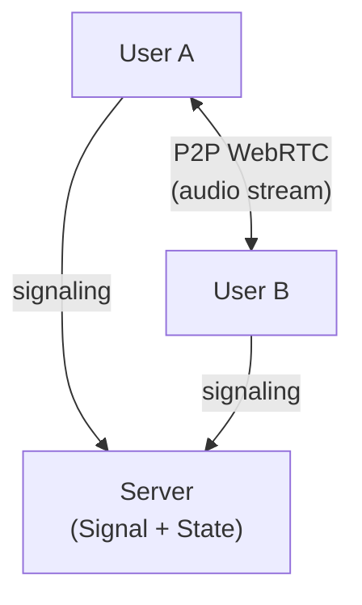

- WebRTC P2P (1-on-1 only) with self-hosted STUN for NAT traversal — media is end-to-end encrypted by DTLS-SRTP between the two peers
- **E2E-authenticated signaling** — every SDP offer/answer and ICE candidate travels as a pairwise-Olm envelope sealed to the peer's pinned E2E device (`docs/e2e-dm-spec.md` §20). The server relays signals opaquely and cannot substitute DTLS fingerprints; a plaintext signal aborts the call rather than downgrading. The call panel shows a lock once the peer device is pinned.
- **Self-hosted STUN server** — coturn in STUN-only mode (`--stun-only --no-auth`) runs alongside the Voxium backend via docker-compose. STUN is stateless UDP (~100 bytes each way) that tells each peer its public IP:port — no media flows through it. Privacy-first: no third-party STUN/TURN servers. The frontend derives the STUN URL from the `VITE_WS_URL` hostname + port 3478, or takes `VITE_STUN_URL` when it is set (`utils/stunUrl.ts`: only `stun:` / `stuns:` `host[:port]` is accepted, a malformed value is logged and ignored in favour of the derived URL, and `turn:` is refused on purpose). It is compiled into the bundle, so changing it means rebuilding the desktop installers.
- **Perfect Negotiation pattern** — resolves offer glare (both peers sending offers simultaneously) via polite/impolite roles based on userId comparison
- **Mutually exclusive** with server voice — joining one leaves the other (cross-cleanup on both server and client)
- Redis-backed call state (`dm:voice:users:{convId}` hashes, `dm:voice:call:{userId}` reverse lookup, `dm:voice:active` set) — DM calls work across cluster nodes
- System messages ("Voice call started" / "Voice call ended") persisted to DB as `type: 'system'`
- Call offer broadcasts to `dm:{conversationId}` room; incoming call shown via `IncomingCallModal` with looping ringtone (stops on accept/decline/cancel)
- DM call UI has two layers: `DMCallPanel` renders inline in `DMChatArea` (full avatars + controls when viewing the conversation), and `DMVoicePanel` is a compact global panel rendered in both `ChannelSidebar` (after `VoicePanel`) and `DMList` so the user always sees their DM call status from any view

### Audio Processing Pipeline

Two cleanly separated pipelines (follows Jitsi/Matrix pattern):

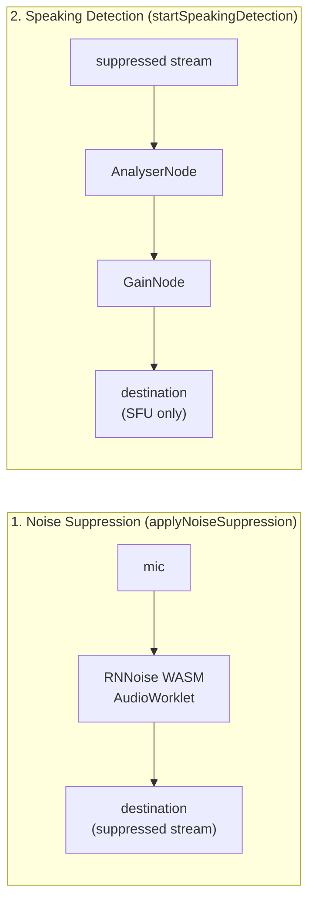

1. **Noise Suppression** (clean, isolated — `applyNoiseSuppression()`):
   Uses `@timephy/rnnoise-wasm` (fork of `@jitsi/rnnoise-wasm`) with the Jitsi `NoiseSuppressorWorklet` (circular buffer, LCM-based sizing, 480-sample frame handling). Nothing else in the audio path. Returns a clean suppressed stream used by both SFU producers and DM P2P peers.

2. **Speaking Detection** (read-only side-chain — `startSpeakingDetection()`):
   Taps into the already-suppressed stream. The gain gate only matters for SFU producer pause/resume (saves bandwidth). DM mode bypasses the gain gate — DM uses the suppressed stream directly.

- **Live toggle:** Noise suppression can be enabled/disabled mid-call. A generation counter prevents race conditions on rapid toggles.
- **Push-to-talk:** Works in both server voice and DM calls. PTT overrides mute — pressing the key temporarily enables the mic regardless of mute state. `pttActive` store state drives the speaking indicator so the green ring shows during PTT even when muted.
- **Browser noiseSuppression inversion:** When RNNoise is enabled, the browser's built-in `noiseSuppression` getUserMedia constraint is disabled to avoid double-processing.

---

## End-to-End Encryption

Authoritative spec: `docs/e2e-dm-spec.md`. Summary of what ships and how it fits the architecture:

### Engine

- **vodozemac WASM** (the audited Rust implementation of the Olm/Megolm double-ratchet protocols used by Matrix), wrapped in `packages/crypto-engine`. Hard rule: **no cryptography implemented in JavaScript** — the JS layer only orchestrates engine calls.
- Key material lives in an IndexedDB vault, pickled under a key held in the OS keychain via Tauri (localStorage fallback for browser dev). The server only ever stores ciphertext, public keys, and sealed key shares.

### Encrypted DMs (always on)

- Every DM is end-to-end encrypted — there is no opt-in and no plaintext fallback; clients refuse plaintext user messages outright.
- **Megolm group sessions** encrypt the message stream; session keys are delivered per recipient device over **pairwise Olm sessions**. Attachments are encrypted client-side and stored as opaque blobs with server-forced generic names.
- **Multi-device:** up to 5 devices per account. New devices link via a short displayed code; revoking a device re-keys every conversation away from it immediately.
- **Cross-signing:** one account master key signs devices, giving one safety number per account (verified out-of-band). Identity changes surface blocking warnings that must be explicitly accepted.
- **Backups:** encrypted account-key backup unlockable with a recovery key, plus message-key backup so history follows the account onto new devices.
- **Search** over encrypted conversations runs client-side against this device's decrypted history — the server cannot index what it cannot read.

### Secure Channels (invite-only E2E server channels)

- A `secure: true` channel grants access **only** via explicit channel membership — the permission calculator checks membership *before* the owner/ADMINISTRATOR fast paths, so even the server owner sees nothing without an invite.
- Opacity as a design rule: every non-member probe answers exactly like a nonexistent channel. Moderation is deliberately blind — admins get a count endpoint and delete-by-id, never contents.
- Same Megolm machinery as DMs via scope strings (`ch:{channelId}`); membership changes rotate the group session, and new members receive no history by design.

### Secure Voice Channels (E2E audio through the SFU)

- A secure channel of type `voice` encrypts every Opus frame on the sender's device (AES-256-GCM, the `voxv1` frame format) before it is packetized, through WebRTC encoded transforms running in a worker (`services/e2e/voiceFrameTransform.ts`, `voiceFrameCipher.ts`, `workers/voiceFrameCrypto.worker.ts`). mediasoup forwards payloads it cannot decrypt. Spec: `docs/e2e-dm-spec.md` §21.
- Each participant owns a sender key; keys are sealed in pairwise-Olm envelopes (scope `chv:{channelId}`, `services/e2e/secureVoiceKeys.ts`) and relayed by the server as opaque `voice:e2e:key` payloads. The server checks that both ends are in the channel and the envelope's shape, never its contents, and stores no key.
- Keys follow membership: a joiner receives a hash-ratcheted key (no past audio); a departure, kick or device revocation rotates to fresh keys for everyone remaining (no future audio), and removing a secure member force-evicts their live voice connection cluster-wide.
- No plaintext fallback: a runtime without encoded transforms cannot join, and a transform failure closes the producer and leaves. v1 is audio-only (screen sharing is refused in a secure voice channel), and the server cannot moderate inside the room by design (members hold CONNECT and SPEAK only).

### E2E-Authenticated DM Call Signaling

- DM call media was always P2P DTLS-SRTP; the signaling relay was the MITM surface. Every `dm:voice:signal` payload is now a pairwise-Olm envelope pinned to the peer's call device, with epoch/sequence ordering, replay defense, and a hard cutover: non-envelope signals abort the call.

### What stays plaintext (by design)

- Server text channels (except secure channels) — moderation-friendly community spaces.
- Voice in ordinary (non-secure) server channels: media terminates at mediasoup, so the SFU can read it; only secure voice channels are end-to-end encrypted. Screen share is never end-to-end encrypted (its video payload descriptors must stay readable by the SFU; partial-frame encryption is deferred).
- Metadata: participants, timing, sizes, and for secure voice the speaking indicator (a client-reported bit) and the per-packet `ssrc-audio-level` RTP header extension, which rides outside the encrypted payload (spec §21.1) — the same envelope visibility as Signal-style designs generally.

---

## Authentication & Security

### JWT Token Flow

**Where the client keeps the tokens.** `services/tokenStorage.ts` holds the session in memory (synchronous reads for the REST interceptor and the socket) and writes it through to a store. In the Tauri desktop app that store is the OS credential store — Windows Credential Manager / macOS Keychain / Linux Secret Service, through the `session_secret_*` Tauri commands and the `keyring` crate, service `app.voxium.session`, the same keyring the E2E pickle key uses — where the access + refresh token pair is one entry and the TOTP trusted-device token another; nothing is written to the webview's localStorage, and an install that kept its tokens there is migrated into the keychain on its first launch. In a browser the store is localStorage ("Remember me") or sessionStorage. "Remember me" off keeps a desktop session in memory only. The store is loaded once at launch (`hydrateTokens()`) before the session restore (`authStore.checkAuth`: single-flight, a 15 s deadline over the whole attempt, retried on a 2 s → 30 s back-off after a transport failure; only a refusal ends the session, and a sign-in or logout voids an attempt still in flight). In the web client, a sign-out or sign-in in another tab is followed through `storage` events.

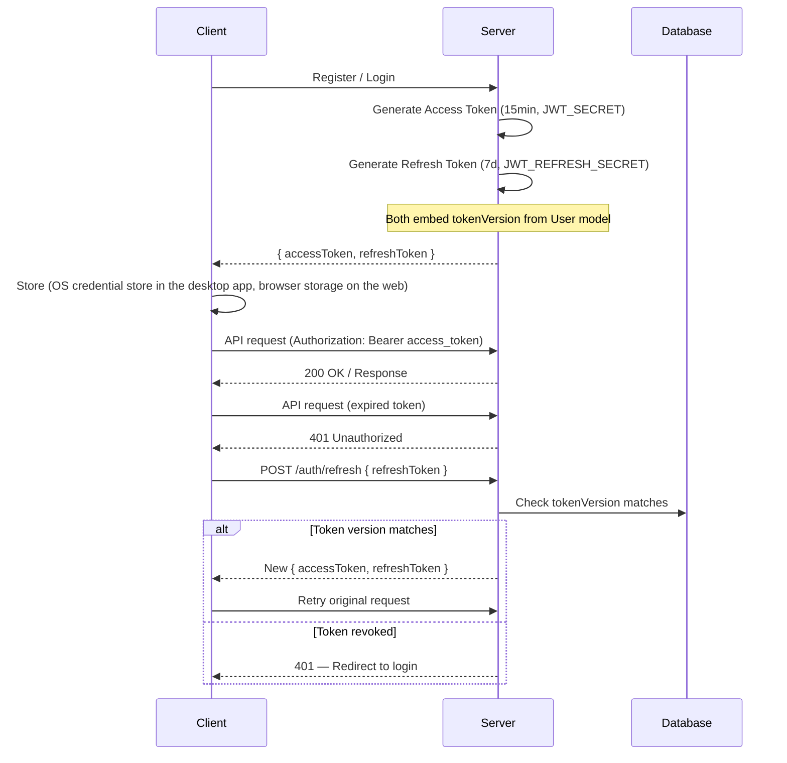

The client renews in one place (`services/session.ts`): a single-flight refresh shared by the REST client and the socket, a token renewed before it is sent when its own `exp` (read on the server's clock, learnt from each renewed token's `iat`) says it has expired (a window restored after a long minimize), and a session that ends only on a 401 or 403 answer to the refresh or with no refresh token to send — a network error, a server error or a rate limit fails that one request and keeps the tokens, and a renewal that lands after a logout stores nothing. The socket handshake answers an expired access token with `Token expired` (any other token failure stays `Invalid token`; a failing database lookup answers `Authentication unavailable` instead, and on REST surfaces as a 500, never a 401, so a database blip cannot sign anyone out). A refusal by the server closes the socket.io manager for good, so the client reopens the socket itself: with the stored token when a REST request renewed it meanwhile, after one renewal otherwise, and after a growing wait for `Authentication unavailable`; transport failures are left to the manager, which retries without limit. The resume handler (`services/resume.ts`, on the window becoming visible or the network coming back) reopens a dropped socket at once with a live token, unless a handshake is already on the wire.

### Password Reset Flow

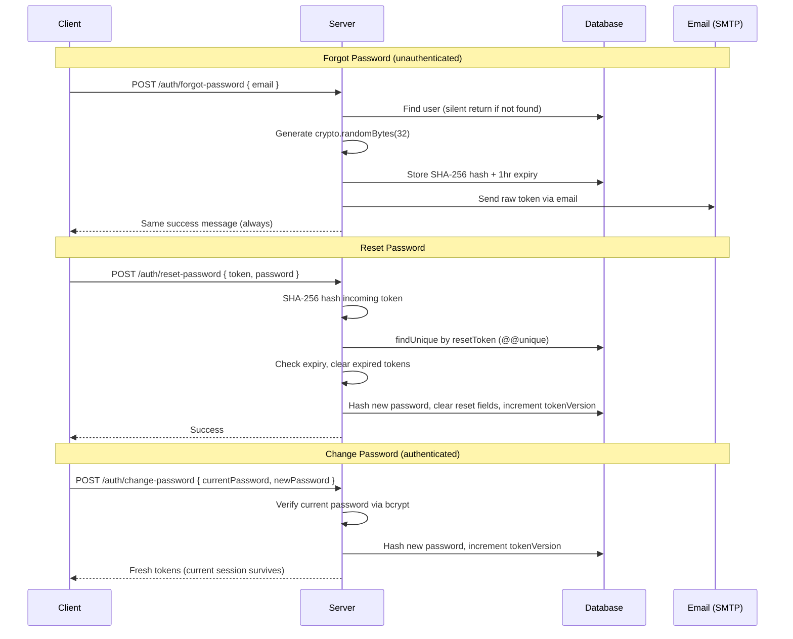

### Email Verification Flow

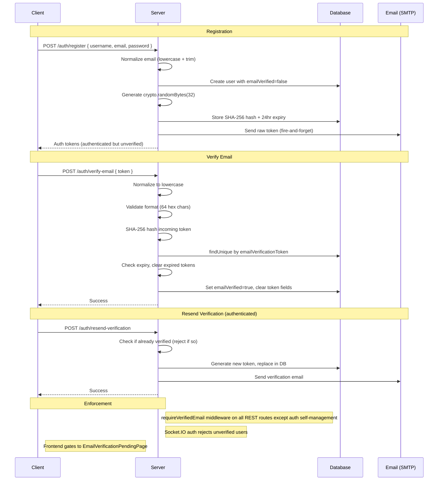

### Security Measures

| Layer | Protection |
|-------|-----------|
| Transport | HTTPS in production |
| Headers | Helmet.js (CSP, HSTS, X-Frame, etc.) + Tauri CSP (restrictive `connect-src`, `script-src`, etc.) |
| Auth | JWT with short expiry + refresh rotation + tokenVersion invalidation + `algorithms: ['HS256']` pinning + purpose field rejection (prevents token type confusion) |
| Passwords | bcrypt with 12 salt rounds, PASSWORD_MAX=72 (matches bcrypt's actual input limit) |
| Password Reset | SHA-256 hashed tokens, 1hr expiry, single-use, anti-enumeration |
| Email Verification | SHA-256 hashed tokens, 24hr expiry, single-use, format validation (64 hex chars, lowercase normalized), `requireVerifiedEmail` on all functional routes + attachment proxy + Socket.IO, StrictMode double-POST guard, migration preflight duplicate check |
| Registration | Generic "Username or email already in use" error prevents email enumeration; email normalized to lowercase; Nodemailer structured address prevents header injection; full anti-bot pipeline (see Registration Abuse Defenses below) |
| CORS | Explicit origin whitelist (must include Tauri origins: `https://tauri.localhost` Win, `tauri://localhost` macOS, `http://tauri.localhost` Linux). No `withCredentials` on client (Bearer tokens, not cookies) — avoids strict CORS mode that breaks on custom protocol origins. Server CORS echoes first allowed origin on null-origin requests instead of `*` |
| Input | Server-side validation on all endpoints + runtime type validation on all Socket.IO payloads |
| SQL Injection | Prisma parameterized queries |
| IDOR | Message edit/delete verify channelId match + server membership; cross-channel manipulation blocked |
| WebSocket | JWT verification on connection + purpose field rejection + runtime payload validation |
| Input Sanitization | HTML tag stripping + trim on all user-generated text (defense-in-depth) |
| Rate Limiting | rate-limiter-flexible with Redis (per-endpoint + per-socket), fail-open with in-memory fallback; complete coverage on all write endpoints and socket events |
| TOTP 2FA | AES-256-GCM encrypted secrets at rest (`TOTP_ENCRYPTION_KEY`), bcrypt-hashed backup codes, 30-day trusted device JWTs with tokenVersion validation, dedicated rate limiter, Redis-based replay protection (90s TTL) |
| Admin | Role hierarchy enforcement — admins cannot ban/delete peer admins (superadmin required) |
| S3 Uploads | Presigned PUT URLs enforce Content-Type via `signableHeaders`; proxy streaming for attachments (S3 URL never exposed) |
| Trust Proxy | Conditional on `NODE_ENV=production` or `TRUST_PROXY=true` — prevents IP spoofing in dev |
| CI/CD | GitHub Actions use env vars for attacker-controlled context (never interpolated in `run:`) |

### Registration Abuse Defenses

Registration is the cheapest attack surface on any open platform — bots feed
breached-credential email lists through the form to squat accounts, validate
stolen addresses, and turn the verification mailer into a spam cannon. The
defense is layered so that each layer catches what the previous one cannot,
and everything is self-hosted (no captcha services, no IP-reputation APIs —
nothing about a visitor leaves the infrastructure):

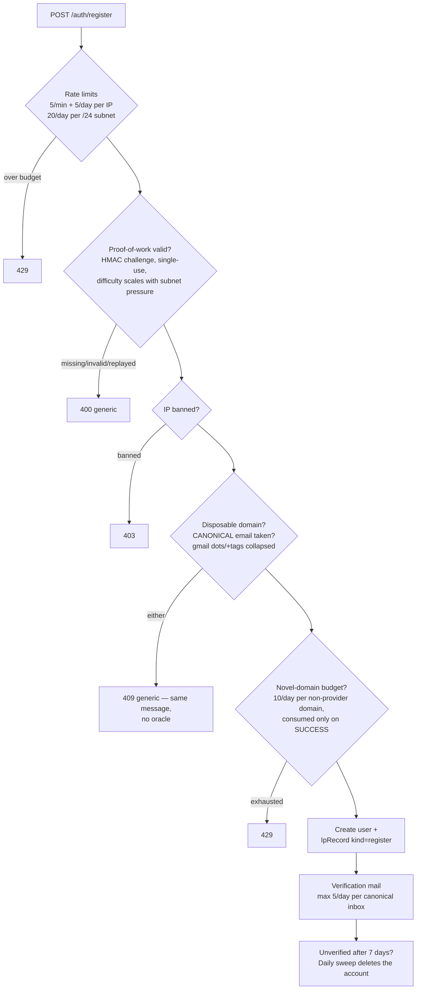

Key mechanisms:

| Mechanism | What it defeats |
|-----------|-----------------|
| **Canonical email uniqueness** (`email_canonical`, unique) — lowercase everywhere; gmail-family additionally strips dots and `+tags` | One Gmail inbox minting unlimited "unique" addresses (`j.o.h.n+x@gmail.com` ≡ `john@gmail.com`) |
| **Proof-of-work** — self-hosted, ALTCHA-style; server-enforced so direct-API scripts pay the same CPU as browsers; HMAC key derived from `JWT_SECRET` (cannot be unconfigured); base 16 bits, +2 per same-subnet registration that day (each step quadruples the work) | Off-the-shelf bot tooling; makes distributed campaigns pay per attempt. Known limit: a native SHA-256 solver is ~100× faster than browser WebCrypto — PoW raises cost, it does not make registration impossible |
| **Long-window budgets** — 5/IP/day, 20 per /24 (IPv6 /48) per day, 10 per novel email domain per day (major consumer providers exempt; domain budget consumed only on successful create so garbage attempts cannot lock out a legitimate small-org domain) | Slow drips that slide under per-minute limits (one signup every 45 min = 32/day); catch-all domains that defeat the disposable blocklist |
| **IP attribution + bans at the door** — registration records an `IpRecord` with `kind: 'register'` (offline geoip, never a third-party lookup); `IpBan` is enforced at registration, login, and socket connect | Anonymous registration; banned sources re-registering |
| **Mail caps per canonical inbox** — 5 verification + 5 password-reset sends per day, regardless of source IP or account; reset cap skips silently (that endpoint must answer identically for existing and unknown emails) | Drip-harassment of breached-list victims; SMTP reputation damage |
| **Unverified-account TTL** — daily 4:30 AM sweep deletes accounts unverified after 7 days (guards: `role='user'`, no owned servers); the same sweep expires `IpRecord` rows unseen for 180 days (GDPR retention) | Bot harvests holding value; squatted usernames/emails; indefinite IP retention |
| **Observability** — `/admin/registration-stats` + the Users-tab panel (signups/hour and /24h, unverified backlog, top registering IPs and email domains over 7 days); hourly spike check mails the operator at 30+ signups/hour (Redis-deduped, one sender across the cluster) | Waves progressing unnoticed; the ultimate backstop is operational — the `registration` feature flag is a live killswitch |

All counters are Redis-backed under the `rl:` prefix (admin-tunable at runtime,
covered by the same clearing paths as every other limiter), so the whole
pipeline is multi-node correct by construction.

### TOTP Two-Factor Authentication Flow

```
Setup (authenticated):
  POST /auth/totp/setup
    → Generate 20-byte secret (otpauth library)
    → Encrypt secret with AES-256-GCM → store in user.totpSecret
    → Return base32 secret + QR code data URL

  POST /auth/totp/enable { code }
    → Decrypt stored secret, validate TOTP code (window: 1)
    → Generate 8 backup codes → bcrypt hash each → store in user.totpBackupCodes
    → Set totpEnabled = true
    → Return plaintext backup codes (shown once)

Login with TOTP:
  POST /auth/login { email, password, trustedDeviceToken? }
    → Verify credentials
    → If trustedDeviceToken valid (30d JWT, matching tokenVersion) → skip TOTP
    → If totpEnabled → return { totpRequired: true, totpToken } (no auth tokens)

  POST /auth/totp/verify { totpToken, code }
    → Validate totpToken JWT (5min expiry, purpose: 'totp-verify')
    → Try TOTP code first; if invalid try backup codes
    → Backup code match: remove atomically via optimistic concurrency
    → Return { accessToken, refreshToken, trustedDeviceToken }

Disable (authenticated):
  POST /auth/totp/disable { code }
    → Accept either TOTP code or backup code
    → Clear totpEnabled, totpSecret, totpBackupCodes
```

### Permission Model

```
Permission = one bit of a 22-flag BigInt bitmask (stored as a decimal string)
  packages/shared/src/permissions.ts: Permissions, ALL_PERMISSIONS,
  DEFAULT_EVERYONE_PERMISSIONS (VIEW_CHANNEL, SEND_MESSAGES, ADD_REACTIONS, CONNECT, SPEAK)

Role (per server, with a position)  →  base = @everyone | every role the member holds
Channel override (per role, per channel: allow / deny / inherit)  →  applied over the base
```

- **Roles and overrides.** Every server has an `@everyone` role (position 0) plus custom roles (`Role.position`, `Role.permissions`), assigned through `MemberRole`. A `ChannelPermissionOverride` carries `allow` and `deny` bitmasks for one role in one channel; a bit in neither is "inherit". Order: `@everyone` override, then the member's role overrides aggregated (allow wins over deny at the same level). Overrides can never grant `ADMINISTRATOR`, `CREATE_SECURE_CHANNELS` or `MANAGE_WEBHOOKS` (stripped in `routes/roles.ts`; the last two are server-level only).
- **The calculator** (`utils/permissionCalculator.ts`) is the single source of truth: `computeServerPermissions()` and `computeUserChannelPermissions()` give non-members `0n` and the owner every bit, and `ADMINISTRATOR` bypasses channel overrides. Route guards ask it for a flag (`hasServerPermission`, `hasChannelPermission`) instead of comparing a role name; `filterVisibleChannels*` applies `VIEW_CHANNEL` in batches.
- **Role hierarchy.** An actor cannot create, edit, delete, reorder or assign a role at or above their own highest position (`getHighestRolePosition()`; the owner is `Infinity`), nor set overrides for permissions they do not hold themselves.
- **Secure channels are membership-derived.** The calculator checks `secure` before the owner and `ADMINISTRATOR` fast paths: only a `ChannelMember` row grants access, the owner and admins are pierced, and a member gets a fixed set (`SECURE_*_PERMISSIONS`) regardless of roles.
- **Legacy label.** `ServerMember.role` (`owner` | `admin` | `member`) remains as a derived label, re-synced when a member's roles change (`admin` when a role grants `ADMINISTRATOR`, `MANAGE_CHANNELS` or `MANAGE_SERVER`). The admin app and the member lists (the People panel's staff-first ordering, the directory's role filter) read it; permission checks do not.

### Feature Flags

Redis-backed feature flag system for toggling features without redeployment:

```
Redis Hash: feature:flags
┌───────────────────┬─────────┐
│ registration      │ true    │  ← Gate: POST /auth/register
│ invites           │ true    │  ← Gate: POST /invites/servers/:id, POST /invites/:code/join
│ server_creation   │ true    │  ← Gate: POST /servers
│ voice             │ true    │  ← Gate: voice:join socket event
│ dm_voice          │ true    │  ← Gate: dm:voice:join socket event
│ support           │ true    │  ← Gate: POST /support/open
│ community_funding │ false   │  ← Landing page: the community funding section
│ annotations_v2    │ true    │  ← Screen-share annotation wire v2 (server-first rollout)
│ server_discovery  │ true    │  ← Gate: every /discovery route (Explore); invites, bans, memberships keep working
│ webhooks          │ true    │  ← Gate: the public webhook execute route and every /servers/:id/webhooks route; rows are kept; the /admin webhook routes are not gated
└───────────────────┴─────────┘
```

- Defaults defined in `featureFlags.ts`, overrides persisted to Redis `feature:flags` hash
- In-memory cache for zero-latency checks via `isFeatureEnabled(name)`
- Loaded on server startup via `loadFeatureFlags()`
- Admin API: `GET/PUT /feature-flags/:name`, `POST /feature-flags/:name/reset`
- Changes take effect immediately (no restart needed)

### Rate Limit Registry

Every rate limiter is registered in a central `DEFAULTS` record with admin-editable overrides:

```
Redis Hash: rl:config
┌────────────────┬───────────────────────┐
│ limiter name   │ {points, duration,    │
│                │  blockDuration}       │
└────────────────┴───────────────────────┘
```

- Overrides loaded from Redis on startup, cached in memory
- Limiter instances nulled on config change → recreated on next request
- Admin API: `GET /rate-limits`, `PUT /rate-limits/:name`, `POST /rate-limits/:name/reset`, `POST /rate-limits/clear-user`
- The api-level general budget is per USER once signed in (`generalUser`, 600 requests/min; the limiter verifies the bearer's signature itself, before `authenticate`) and per ADDRESS for anonymous traffic (`general`, 1000/min), so a company behind one egress address is never bounded as a whole; one active client measures 35–60 requests/min
- Key types: `ip` (shared by everyone behind one address, so sized for a group), `userId` (every write and expensive read, and the signed-in general budget), `account` (the account a sign-in is FOR, before anyone is authenticated: on `/login` an HMAC of the lowercased, trimmed e-mail together with the caller's network, so a stranger elsewhere cannot lock an account; on `/totp/verify` the user of a challenge token whose signature verifies), `webhook`
- The sign-in buckets count failures only (`refundOnSuccess`: the point is consumed atomically and refunded on a 2xx, or on a 429 a later bucket answered): 20 failures/min per address with a 5-minute block, 60/min per /24 or /48, 10 failures per 15 minutes per account and network (TOTP: per account) with no block
- Behind a reverse proxy the process does not trust (`NODE_ENV` not production and `TRUST_PROXY` not true), every client is one address; the server warns once when it sees `X-Forwarded-For` in that state. CORS exposes `Retry-After` so cross-origin clients can honour it

### Server Invite Lock

Per-server invite control independent of the global `invites` feature flag:

- `Server.invitesLocked` boolean field (default `false`)
- Owners and admins can toggle via `PATCH /servers/:id/invites-lock`
- Checked on invite creation and invite join (returns 403 when locked)
- Broadcast to all members via `server:updated` socket event
- One of the four inputs of the directory listing column (below): locking invites hides the space from Explore

### Server Discovery (Explore)

A searchable, hand-curated directory of spaces with join requests.

- **Listed by default, approval-first.** Every server is listed unless its owner hides it (`discoverable`), its invites are locked, a platform admin blocked it (`discoveryBlockedAt`) or its owner is platform-banned — the four inputs of the materialised `discoveryListed` column, recomputed by `utils/discoveryListing.ts` at every write site so the listing query never joins. The join mode is `approval` (join requests, decided by holders of KICK_MEMBERS or ADMINISTRATOR and the owner) or `open`.
- **Profile.** An optional description (≤ 300 characters) and up to 5 tags from a fixed vocabulary of 12 (labels translated in all 11 locales), edited in Space Settings → Discovery (MANAGE_SERVER) and broadcast over `server:updated`.
- **API** (`routes/discovery.ts`, behind the `server_discovery` flag, sign-in required): `GET /discovery/servers?q&tag&sort&cursor&limit` → `{ featured, servers, nextCursor, totalCapped }` (sorts `active` / `members` / `newest` / `name`; 3-character search minimum; 24 per page, 48 max; 1,200-row depth cap; a 60 s Redis cache of the public part of each page with the viewer's `isMember` / `requestPending` computed fresh), `GET /discovery/servers/:id`, `POST /discovery/servers/:id/join` (open mode joins; approval mode creates a pending request, 202) and `DELETE …/join` (cancel). Owner side in `routes/servers.ts`: `GET /servers/:id/discovery` (the tab's figures and curation state, MANAGE_SERVER), `PATCH /servers/:id/discovery`, join-request list / approve / decline, bans list / unban. Admin: `PATCH /admin/servers/:id/discovery` (feature / block, audited) and `GET /admin/servers?listed=1`.
- **Membership helpers.** `utils/serverJoin.ts` (`joinServerMember`) is the join path for invites, open joins and approved requests: it checks the `ServerBan` first and maintains `Server.memberCount` inline in the same transaction. `utils/removeMember.ts` (`removeMemberFromServer`) serves kick and leave; a kick writes a `ServerBan` (lifted from the Members tab), a voluntary leave does not. The admin delete-user ownership transfer and account deletion (`utils/accountDeletion.ts`) keep the counter themselves.
- **Scale.** One composite index per sort, signed keyset cursors (`utils/discoveryCursor.ts`), no joins on the listing query, capped totals; measured at one million listed spaces with no sequential scan on the request path (`scripts/seed-discovery-load.ts` seeds that load into a throwaway database; `scripts/measure-discovery.ts` times every query shape the directory serves and fails if any plan sequentially scans `servers`, `server_members` or `messages`).
- **Statistics.** `utils/discoveryStats.ts` refreshes `onlineCount` / `weeklyMessages` / `activityScore` for the stalest listed servers in bounded batches every 5 minutes under a cluster lock (every listed server within 24 h, 48 h under backlog, which is logged); nothing runs on the message path; the Active weights are one shared constant (`DISCOVERY_SCORE_WEIGHTS`) and the card prints the three inputs of the score.
- **Badges.** An activity tier on every card (Bronze, Silver, Gold, Platinum, Diamond) from the SAME score and nothing else: a rank among listed spaces with any activity — the top half, 25%, 10%, 3% and 1% (`DISCOVERY_TIER_TOP_FRACTION`), none below `DISCOVERY_TIER_MIN_POPULATION` active spaces. `utils/discoveryTiers.ts` computes the cuts in one `percentile_disc` statement (a tier starts one above the boundary score: strictly the top fraction, never more) (hourly with the housekeeping, and at once when the Redis key `discovery:tiers` is missing), the directory stamps `tier` on each public card, and `GET /servers/:id/discovery` tells the owner their tier, their score and the score the next tier starts at. The crest is `components/discovery/TierBadge.tsx` (pure SVG, metal per tier, one to five stars). No votes: Featured stays the hand-picked row.
- **Safety.** Opacity (a hidden id answers 404 on every directory endpoint, byte-identical to a nonexistent one), `discoveryBrowse` 60/min and `discoveryJoin` 10/h per user, one pending request per server per user, a 7-day cooldown after a decline, join-request events only to the moderator audience (`utils/moderatorAudience.ts`), report-from-card (`POST /reports` with `type: 'server'`: a snapshot of the listing, the owner as the reported user), admin Feature / Block with audit rows, and the `server_discovery` kill switch.
- **Client.** `components/discovery/DiscoveryModal.tsx` (Explore, reached from the Explore compass in the spaces strip (icon-only below 1200 px), the space switcher's no-match offer and the create/join dialog, all through the strip's one mount point), `stores/discoveryStore.ts` (reconciled against the spaces strip), `components/server/DiscoveryTab.tsx` (the Discovery tab), the join-request and banned sections of Space Settings → Members, and the four socket handlers in `services/discoverySocketHandlers.ts`.

### Incoming Webhooks

A text channel gets a secret URL; anything that can POST JSON to it makes a message appear there under a name the space's moderators chose. Incoming only: Voxium makes no outgoing call, and a webhook is not an account.

- **Data model** (migrations `20261018120000_webhooks` and `20261019090000_webhook_owner_decisions`, both additive). Table `webhooks`: `server_id` and `channel_id` (cascade with the server or channel), `name` (1–64 characters), `type` (`generic` | `github`, chosen at creation), `token_hash` (SHA-256 hex of the token), `secret_enc` (GitHub only, the signing secret sealed with AES-256-GCM), `enabled`, `created_by_id` (SET NULL when the account goes), `last_used_at`, and from the second migration `admin_disabled_at` (the sticky admin lock), `creator_removed_at` (a kick, ban or platform ban of the member who held the live URL disabled it), `last_rotated_at` and `last_rotated_by_id` (FK to `users`, SET NULL); indexed on `server_id` and `channel_id`. `messages.author_id` becomes nullable, and `messages` gains `webhook_id` (FK, `ON DELETE SET NULL`, so a webhook's messages outlive it) and `webhook_name` (the name the message was posted under, frozen at post time), with an index on `webhook_id`. A message has an `author_id` or a `webhook_name`; the write paths that create channel messages (the human POST and the execute route) keep that invariant. `max_webhooks_per_server` joins the resource limits: `global_config` (default 10) and `server_limits` (nullable = inherit); 0 stops creation on a server, existing webhooks keep working.
- **One author shape on the wire.** Every server reader of messages (channel history, replies and their quotes, search, DMs, DM call notices) shapes its rows through `utils/messageAuthor.ts`: a webhook row gets a synthesised author `{ id: 'webhook:{webhookId}' | 'webhook:deleted', username, displayName: <webhook name>, avatarUrl: null, isWebhook: true }`, so `Message.author` stays non-null for clients. The colon is deliberate: such an id can never pass the server's opaque-id check, so it can never be looked up as a user. The message `type` stays `user`, so webhook posts are searchable.
- **Execute** (`POST /api/v1/webhooks/:webhookId/:token`, `routes/webhookExecute.ts`, public, no account). Mounted in `app.ts` after the access logger and compression, BEFORE the global 100 KB JSON parser and OUTSIDE the `api` router, so it is not under the per-IP general limiter: GitHub's deliveries to every server share a few egress addresses. A middleware chain in which each guard is cheaper than the next:

  ```
  [router]  webhooks flag (403) → per-IP limiter (webhookExecuteIp)
  [route]   Content-Type application/json (415)
            → token check: one query; SHA-256 of the token compared in constant time;
              unknown id and wrong token → the same 404; disabled → 403
            → generic: per-webhook limiter (webhookExecute), only on a valid token
            → GitHub: one point each of webhookSigFail (per webhook and address) and
              webhookSigFailIp (per address), consumed before the body is read; 429
              when either is spent
            → 1 MB JSON parser (GitHub: X-Hub-Signature-256 checked over the raw bytes
              before parsing; 401 on a mismatch; a match gives both points back)
            → GitHub: per-webhook limiter (webhookExecute), only on a valid signature
            → render by type → insert → message:new to channel:{id} → last_used_at (≤ 1 write/min)
  ```

  A GitHub webhook's per-webhook bucket is charged only once the signature has checked out, and nothing is ever refunded: the parser can fail before it reaches the signature (an unsupported charset or encoding, an oversized or aborted body), so a point charged earlier would stay charged and whoever holds the URL without the secret could starve the real deliveries. Unverified deliveries are counted instead, in two buckets consumed atomically before the body is read and given back once the signature matched (or a later bucket answered 429): `webhookSigFail`, keyed on the webhook AND the sender's address (never the webhook alone, which would let a URL holder block the real deliveries), and `webhookSigFailIp`, on the address alone, so one address cannot multiply the first by spreading its failures over many webhooks. Each therefore counts the deliveries in flight as well as those that never proved the secret (a wrong or missing signature, an oversized or aborted body); once one is spent, that address's next deliveries answer the standard 429 before their body is read or hashed, while every other address keeps delivering. The per-address figure is generous because GitHub's deliveries for every webhook share a few egress addresses: a repository hook carrying a wrong secret spends it for everyone behind that address. A generic webhook has no second credential, so its bucket is charged right after the token check.

  204 on success, 200 with the created message under `?wait=true`; an oversized or malformed body answers 413 or 400 in the house shape. No mention is ever extracted or resolved for a webhook row, on write or on read, and webhook posts never count towards the discovery activity score.
- **Generic renderer: the Discord shape** (`utils/webhooks/discordPayload.ts`). Every monitoring, CI and forge tool already ships a Discord notifier, so the Discord webhook payload is the generic payload: `content`, `username` (a per-message name, cut to 64 characters), `embeds[]` (at most 10; `title`, `url`, `description`, `author.name`, `fields[]` at most 25, `footer.text`, `timestamp`). Everything else (`avatar_url`, `tts`, `allowed_mentions`, components, attachments, embed colours, images, thumbnails, icons, …) is ignored, never an error. Each embed is flattened at ingest into one blockquote (author, title as a bold link, description, one line per field, footer and timestamp) and stored as ordinary message content, so it is searchable and renders through the existing markdown allowlist. Rendered content over 4000 characters is rejected, not truncated.
- **GitHub formatter** (`utils/webhooks/githubFormatter.ts`). A webhook of type `github` carries a signing secret that Voxium generates (32 random bytes, hex), shows once next to the URL, renews on rotate and stores only sealed (`utils/secretBox.ts`, keyed by `TOTP_ENCRYPTION_KEY`; without the key, creating or rotating one answers 503). Every delivery is verified before its body is parsed; a missing or wrong signature is a 401 and posts nothing. `ping`, `push` (branch, created, deleted, tag; up to five commits, then "and N more"), `pull_request` (opened, draft, merged, closed, reopened, ready for review), `issues` (opened, closed, reopened) and `release` (published) become one compact line each; every other event or action answers 204 (200 with `data: null` under `?wait=true`) and posts nothing. A GitHub body on a generic webhook, or a delivery without `X-GitHub-Event` on a GitHub one, is a 400 that says which webhook to create.
- **Nothing fetches.** No avatar URL, embed image, link preview or outgoing request: nothing a webhook sends can make a reader's client contact a host the sender chose. Links stay plain anchors, http(s) only; every interpolated single-line field is markdown-escaped and its bare URLs, `www.` hosts and e-mail addresses are put in code spans so the renderer cannot autolink them; GitHub links must point at the repository's own origin or `https://github.com`.

- **Management API** (`routes/webhooks.ts`, mounted at `/api/v1/servers/:serverId/webhooks` inside the `api` router; signed in, verified email, consent, the `webhooks` flag and `MANAGE_WEBHOOKS` on every route): `GET /` (the webhooks on channels the caller can see, plus the server-wide `total` the cap counts; never a token or a secret), `POST /` (`{ channelId, name, type }`; 201 with the token, and the secret for GitHub), `PATCH /:webhookId` (`name`, `channelId`, `enabled`; moving a webhook moves nothing it already posted), `POST /:webhookId/rotate` (a new token, and a new secret for GitHub; the old ones stop working at the commit), `DELETE /:webhookId?purge=1` (the webhook is disabled first, so new deliveries stop at once; then one transaction of up to 60 s, because clearing `webhook_id` on, or deleting, everything a busy webhook posted touches every index of `messages`: the webhook row is locked, then with `purge` every message it posted, in every channel, is deleted with it; without it the messages stay under their stored name). Create and rotate are the only responses that ever carry a token; the client composes the public URL from its own API base. A webhook can only target a text channel of the server that is not secure and that the caller can view and send messages in (on create and on a move): a secure or invisible channel answers exactly like a nonexistent one, a visible one without `SEND_MESSAGES` answers 403, a voice channel answers 400. PATCH and rotate write only while the webhook is still on the channel the caller was checked against (404 if it moved meanwhile), and create counts against the cap under a lock on the server row. Rotate and `PATCH { enabled: true }` also require `SEND_MESSAGES` on the webhook's current channel (one hands out a credential for it, the other re-arms a poster into it); `GET /targets` lists the channels the caller may bind, by the same check, for the pickers. Rotate records who rotated and when (`last_rotated_at`, `last_rotated_by_id`, SET NULL with the account). While a platform admin's disable is in force (`admin_disabled_at`), the owner's `PATCH { enabled: true }` answers 403 `This webhook was disabled by an administrator`.
- **Events.** Every mutation emits `webhook:changed { serverId }` to `server:{id}`, a refetch hint that carries nothing else (a restricted channel's id must never reach the server room, and a token never travels on a socket). A purge emits `message:bulk_deleted { channelId, webhookId, count }` to `channel:{id}` of each channel that lost rows (one count-0 receipt to the webhook's channel when there were none), and a client viewing it drops them and clears their quotes from the replies on screen.
- **Permission.** `MANAGE_WEBHOOKS` (the 22nd flag, bit 21), server-level only: stripped from channel overrides like `CREATE_SECURE_CHANNELS`, part of the admin role preset (`DEFAULT_ADMIN_PERMISSIONS`; no existing role gains it, the migration updates no role), implicit for the owner and ADMINISTRATOR. It is separate from MANAGE_CHANNELS so integrations can be delegated without channel deletion.
- **Desktop.** Space Settings → **Integrations** (`components/server/IntegrationsTab.tsx`), shown to holders of `MANAGE_WEBHOOKS` (a member holding only that bit gets the settings gear and lands on it): the list ("N of M"), a create dialog (name, channel, type), the copy-once panel (`WebhookCreatedPanel.tsx`: the URL, a curl one-liner, and for GitHub the secret with the exact repository settings to enter), an edit dialog (`WebhookEditDialog.tsx`: rename and move; the channel picker lists the targets the caller may bind, keeps the current channel, and sends only the fields the user changed; a fellow moderator's concurrent rename or move is never sent back), rotate, enable / disable, delete with "also delete its messages", and a "turned off" state on the flag's 403. The list is refetched on `webhook:changed`, never written from a mutation response. A webhook message renders with an initials avatar, its name and an APP tag (also in desktop notifications, reply quotes and search results); it opens no profile card, cannot be edited or reported, and is deleted through Manage Messages like any other; the messages of a deleted webhook keep their name, dimmed. `serverStore.ensureMembers` never sends a `webhook:` id to the member lookup, and the E2E display gate strips the webhook fields from every encrypted row (a webhook never posts encrypted or into a DM). The member-facing Limits tab shows the cap.
- **Admin.** `GET /admin/servers/:serverId/webhooks` (the owner's list shape, no token or secret), `PATCH /admin/webhooks/:webhookId` (`{ enabled }`, audited as `webhook.disable` / `webhook.enable`; an admin's disable is sticky: it sets `admin_disabled_at`, which only an admin's enable clears, so the server cannot re-enable meanwhile) and `DELETE /admin/webhooks/:webhookId?purge=1` (the owner's delete transaction, audited as `webhook.delete`), behind the existing admin guard and limiter and NOT behind the `webhooks` flag, so admins can curate during an incident; a Webhooks action per server in the server list; `maxWebhooksPerServer` in the global limits panel and the per-server limits modal; the four limiter rows in Rate limits (the per-webhook one keyed "Webhook"); the `webhooks` flag in Feature Flags. Limit changes are audited as `limits.update_global`, `limits.update_server` and `limits.reset_server` with the values before and after.
- **Safety.** The token is the credential: 32 random bytes, only its SHA-256 stored, compared in constant time, shown once, rotatable, never listed, and redacted from every access-log format (`utils/redactUrl.ts`: `/api/v1/webhooks/{id}/[redacted]`); the reverse proxy in front of it must not keep the raw request line for `/api/v1/webhooks/` in any of its logs either, the error log included (it quotes the request line on upstream errors, so excluding the path from the access log alone is not enough); the deployment notes carry the configuration. Limiters, all `rl:` buckets and admin-tunable: `webhookExecuteIp` 1200/min per IP before the token check, `webhookExecute` 30/min per webhook after it (for a GitHub webhook, after the signature too; Discord's figure), `webhookSigFail` 10/min per webhook and address and `webhookSigFailIp` 300/min per address (GitHub webhooks: deliveries in flight or never verified), `webhookManage` 30/h and `webhookRead` 60/min per user. Body at most 1 MB, JSON only, parsed once, never logged; the body of a request a webhook receives is not kept beyond the message it produced (the access log still records each delivery: its address, method, redacted path, status and response size). Per-server cap through the limits system, per-webhook disable by moderators or an admin, purge on delete, the global kill switch. Unauthenticated posts never ping: no mention resolution and an empty mentions array. A webhook's token belongs to the server, not its creator: it keeps working after the creator leaves on their own, until it is rotated or deleted; a kick or ban disables the webhooks whose live URL the member holds (created by them and never rotated by another, or last rotated by them) and marks them (`creator_removed_at`), since the URL may have left with the member; a platform ban does the same in every server at once; any enable, by the owner or an admin, or a rotate clears the mark (a rotate alone does not re-enable). Deleting a webhook detaches or purges its history in bounded batches before the short locked transaction, so a busy webhook with a long history can always be deleted.
- **Multi-node.** Nothing is node-local: the lookup is PostgreSQL, the limiters are Redis, the broadcast goes through the Socket.IO Redis adapter and the flag through the Redis-propagated registry. A delivery can land on any node; sticky sessions do not matter because no socket is involved. The execute path is one primary-key lookup (two on a hit), one insert, one broadcast and a throttled timestamp write; nothing touches the message read path.

---

## Admin Dashboard

Standalone React app (`apps/admin/`, port 8082) with two-tier role system:

```
apps/admin/
├── src/
│   ├── stores/
│   │   ├── authStore.ts     # Admin login (admin + superadmin roles)
│   │   └── adminStore.ts    # All admin state + actions (Zustand)
│   ├── components/
│   │   ├── AdminLayout.tsx         # Sidebar nav + content router
│   │   ├── AdminDashboard.tsx      # Stats cards + REST metrics + SFU stats + charts
│   │   ├── AdminReports.tsx        # Moderation queue (message / user / server reports; "Block from directory" shortcut)
│   │   ├── AdminSupportTickets.tsx # Support ticket queue + chat panel
│   │   ├── AdminUserList.tsx       # Paginated user management
│   │   ├── AdminServerList.tsx     # Paginated server management + resource limits + directory curation (chips, "Listed only", Feature/Block)
│   │   ├── AdminBanList.tsx        # User bans + IP bans
│   │   ├── AdminAnnouncements.tsx  # Global/targeted announcements
│   │   ├── AdminStorage.tsx        # S3 storage stats (avatars, server icons, attachments, orphans) + file browser with type/status filters + delete/cleanup actions
│   │   ├── AdminRateLimits.tsx     # Rate limit controls (edit/reset rules, clear user counters)
│   │   ├── AdminFeatureFlags.tsx   # Feature flag toggles
│   │   ├── AdminAuditLog.tsx       # Searchable/filterable audit trail
│   │   ├── AdminDataTools.tsx      # CSV/JSON data export
│   │   ├── AdminServerWebhooksModal.tsx # Per-server webhook curation (disable / enable / delete with purge)
│   │   ├── AdminRegistrationPanel.tsx   # Registration abuse controls
│   │   ├── AdminUserDetail.tsx     # Single-user detail view
│   │   ├── AdminGeography.tsx / AdminGlobe.tsx # Geographic view of users
│   │   └── DirectoryChips.tsx      # Discovery state chips (shared by the server list)
│   └── services/
│       ├── api.ts           # Axios with token interceptor
│       ├── socket.ts        # Socket.IO for real-time admin events
│       └── tokenStorage.ts  # Admin session storage
```

### Admin Permission Model

| Action | admin | superadmin |
|--------|-------|------------|
| Full dashboard access | Yes | Yes |
| Ban/unban/delete users, servers | Yes | Yes |
| Manage reports, support tickets | Yes | Yes |
| Edit rate limits, feature flags | Yes | Yes |
| Promote/demote staff roles | No | Yes |

### Admin Real-Time Events

- **Dashboard metrics** — fetched via REST (`GET /admin/stats/live`, `GET /admin/stats/sfu`) with refresh buttons. SFU stats include per-worker transport counts, port utilization, producers/consumers.
- `admin:reports` — Socket.IO subscription for new report notifications → auto-refresh
- `admin:support` — Socket.IO subscription for new ticket/message notifications → auto-refresh
- `admin:metrics` — Socket.IO room for the live metrics stream (`websocket/adminMetrics.ts` emits a snapshot to it while an admin is subscribed)

### Admin Resource Limits

Admins can control server resource allocation:
- **Global limits** (`GET/PUT /admin/limits/global`) — defaults applied to all servers
- **Per-server overrides** (`GET/PUT/DELETE /admin/limits/servers/:serverId`) — nullable fields override global (null = use global)
- Resolution: server override > global config > hardcoded `LIMITS` constants
- Managed in AdminServerList: collapsible global limits panel + per-server settings modal

### Admin Storage Management

Admin dashboard storage page provides full visibility into S3 usage:
- **Stat cards** — Total storage, avatars, server icons, attachments, orphaned files (count + size)
- **Top uploaders** — Users and servers ranked by total storage consumption (avatars + server icons + message attachments aggregated from S3 keys and DB records)
- **File browser** — Filterable table (all/avatars/server-icons/attachments/orphaned) with type badges, status badges (Active/Orphaned/Expired), linked entity display, and per-file delete
- **Bulk cleanup** — Delete all orphaned files (files in S3 not referenced by any DB record)
- **Delete behavior** — Avatar/server-icon deletion removes from S3 and clears the DB reference; attachment deletion marks as `expired: true` in DB (soft-delete) so the chat UI shows an "Expired" placeholder instead of a broken link

### Attachment Lifecycle

Message attachments follow a 3-day retention lifecycle:

1. **Upload** — Client requests presigned PUT URL (`POST /uploads/presign/attachment`), uploads directly to S3. Server validates file type, size, and authorization (server membership or DM participation). S3 key includes context prefix (`attachments/ch-{channelId}/` or `attachments/dm-{conversationId}/`)
2. **Access** — Attachments are proxied through the server (`GET /uploads/attachments/*`) — S3 URLs never reach the client. Authorization is checked per-request (server member or DM participant). Self-healing: if S3 returns `NoSuchKey`, the attachment is auto-marked as expired
3. **Expiry** — A scheduled cleanup job runs daily at 4 AM. It queries `MessageAttachment` records older than `ATTACHMENT_RETENTION_DAYS` (default: 3), marks them as `expired: true` in the DB, then deletes the S3 objects. DB records are preserved for the "Expired" UI placeholder
4. **Report** — After each cleanup run, an email report is sent to `CLEANUP_REPORT_EMAIL` with: status, duration, files expired, storage freed, remaining active attachments, and any errors

### Desktop Notifications

3-tier notification system with avatar support (`services/notifications.ts`):

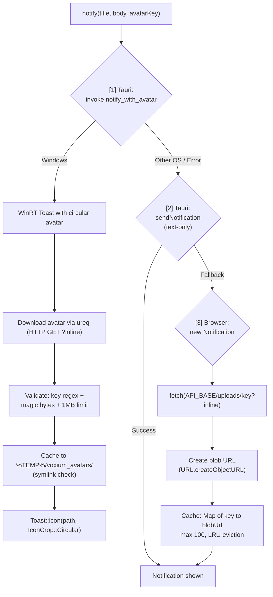

**Security:**
- All Tauri-specific code gated behind `TAURI_AVAILABLE` (`'__TAURI_INTERNALS__' in window`)
- **System tray:** graceful creation — if `TrayIconBuilder::build()` fails (Linux GNOME/Wayland without `libappindicator`), app continues without tray. Close behavior adapts: tray available → hide to tray; no tray → `app.exit(0)` (quit cleanly)
- Avatar key validated against `VALID_AVATAR_KEY_RE` on both frontend (JS regex) and backend (Rust regex)
- Rust: null byte rejection, control char rejection, 128-char key limit, image magic byte validation (PNG/JPEG/WebP/GIF), symlink detection on cached files
- Server: `?inline` proxy forces `Content-Type: image/webp`, `X-Content-Type-Options: nosniff`, `Content-Disposition: inline`

### Presence

A user is online while at least one of their sockets, on any node, is registered: `user:sockets:{userId}` (the socket ids), `socket:users` (socket id → user id) and `online_users` in Redis, plus the `User.status` column the People panel reads. Both transitions are atomic — registration is one MULTI, unregistration one Lua script that removes the socket and decides in the same step whether it was the user's last — so two sockets of one user can never interleave into a partial state.

The connection handler registers the socket and writes the column `online` before anything else, and the `disconnecting` handler waits for that registration before it unregisters; a socket that drops during the setup is therefore always unwound, and never announced online. A disconnect that finds the user already registered again (a page reload whose new socket connected while the old one was being torn down) writes and broadcasts nothing.

Two sweeps keep the keys honest without a disconnect:
- `clearPresenceState()` (`utils/redis.ts`) at startup (before accepting connections) and at graceful shutdown: as the sole node a full wipe, with live peers a scoped reap of the sockets missing from the cluster's adapter snapshot.
- `utils/presenceReaper.ts` every 60 seconds while serving, under the shared cluster lock: the same scoped reap, plus a reconciliation of the users themselves (one the DB column or `online_users` calls online with no live socket registered is taken offline too), followed by a `presence:update` offline to every server and DM room of each user it took offline, unless they registered a new socket by then.

Voice occupancy (`voice:channel_users`) is replayed to a socket on connect and to a member on joining a server (`replayVoiceState()`, stamped `source: 'connect'`), for the channels they can view; the client clears its lists on reconnect because the replay only names channels that have occupants, and ignores the snapshot for the channel it is re-joining itself, whose join answers with a fresher list.

### Email System

Nodemailer transporter (`utils/email.ts`) with configurable SMTP:
- **Verification emails** (`sendVerificationEmail`) — HTML + plaintext with the verify link (`/verify-email/{token}`), 24hr expiry; sent fire-and-forget at registration and again on resend (the resend is capped per canonical inbox)
- **Password reset emails** — HTML + plaintext with reset link, 1hr expiry
- **Cleanup report emails** — HTML + plaintext summary table sent to `CLEANUP_REPORT_EMAIL` after each daily attachment cleanup run
- **Admin alerts** (`sendAdminAlert`) — plain operational text to `CLEANUP_REPORT_EMAIL` (opt-in: unset means no alert); the hourly registration-spike check in `utils/registrationHygiene.ts` is the caller today, Redis-deduped so a sustained wave sends one alert per window across the cluster

### Community Themes

User-created themes with a marketplace for sharing. Themes customize all `--vox-*` CSS custom properties and optional SVG background patterns.

**Data Model** (`CommunityTheme`):
- `colors` (JSON) — key-value map of `--vox-*` CSS variable overrides (validated against `THEME_COLOR_KEYS` from shared)
- `patterns` (JSON, optional) — per-area SVG background patterns for sidebar, channel, chat (type: `none` | `svg`, sanitized via `sanitizeSvg()`)
- `status`: `draft` → `published` → `removed` (admin moderation)
- `installCount` — atomic increment/decrement on install/uninstall
- Composite unique: `[authorId, name]`; indexed on `[status, installCount]` and `[status, createdAt]`

**API Routes** (`/api/v1/themes`):
| Route | Purpose |
|-------|---------|
| `GET /` | Browse published themes (paginated, sort by newest/popular/name, search by name, filter by tag) |
| `GET /mine` | List current user's themes (all statuses) |
| `GET /:themeId` | Get single theme (published or own) |
| `POST /` | Create theme (draft) — validates name, description, tags, colors, patterns |
| `PATCH /:themeId` | Update own theme |
| `DELETE /:themeId` | Delete own theme |
| `POST /:themeId/publish` | Publish draft theme to marketplace |
| `POST /:themeId/unpublish` | Revert to draft |
| `POST /:themeId/install` | Install theme (increments installCount) |
| `POST /:themeId/uninstall` | Uninstall theme (decrements installCount) |
| `POST /:themeId/remove` | Admin: remove from marketplace |

**Frontend Engine** (`services/themeEngine.ts`):
- `applyCustomThemeColors()` — sets `data-theme="custom"` + injects `--vox-*` inline styles on `<html>`
- `applyCustomPatterns()` — injects a `<style id="vox-custom-patterns">` tag with per-area SVG background rules
- `clearCustomThemeColors()` — removes custom properties, restores built-in theme
- Built-in themes (`styles/themes.css`): dark (default), light, midnight, tactical — applied via `[data-theme]` CSS selectors

**Frontend UI** (`components/settings/ThemeEditor.tsx`, `ThemeBrowser.tsx`):
- **ThemeEditor** — live preview with color pickers for all `--vox-*` variables, pattern config per area, JSON import/export
- **ThemeBrowser** — marketplace grid with search, tag filter, sort, install/uninstall tracking
- Settings modal appearance tab: built-in theme selector + custom theme management + the spaces strip mode (`settingsStore.spacesStripMode`: `pinned` keeps the 64 px strip on screen, `auto` folds it into a 132x12 notch under the title bar that slides out as a chamfered panel on hover, focus, Ctrl+Shift+L or tap and folds again after the pointer leaves or 1.5 s after a choice)

**Rate limiting:** `rateLimitThemeManage` (write operations), `rateLimitThemeBrowse` (read operations)

### Internationalization (i18n)

11 languages with RTL support, fully client-side via `i18next` + `react-i18next`.

**Supported Languages:**
`en`, `fr`, `es`, `pt`, `de`, `ru`, `uk`, `ko`, `zh`, `ja`, `ar` (RTL)

**Architecture:**
- Static JSON bundles per language in `i18n/locales/*.json` (~1,800 keys each); user-facing strings say "space" for a community, enforced by `__tests__/i18n/spaceWording.test.ts` (keys and code keep `server`)
- `i18next-browser-languagedetector` for auto-detection (order: `localStorage` → `navigator`)
- Language persisted in `localStorage` key `voxium_language`
- RTL handled via `document.documentElement.dir = 'rtl'` on language change (Arabic)
- Server error messages mapped to i18n keys via `utils/serverErrors.ts` (230+ mappings) — `getTranslatedError()` translates API error responses for display

**Key design decisions:**
- All translations are client-side (no server-side i18n) — backend returns English error strings, frontend maps them to localized keys
- Fallback: `en` for any missing key in other languages
- Direction attribute removed (not set to `ltr`) for LTR languages to avoid Tailwind 4 logical property issues

---

## Scalability Strategy

### Phase 1: Single Node (1K users) — what production runs today
- Single Node.js process
- PostgreSQL + Redis on same machine or nearby
- Simple deployment (a lone node detects it is the sole node and runs full-cleanup boot paths)
- Production runs ONE instance today; the code below is written and tested to run as several

### Phase 2: Multi-Node (10K users) — supported by the code, not shipped as a topology

The code is multi-node correct, but the repository ships no load-balancer configuration, no multi-node manifests (its compose files run one server with Redis and PostgreSQL) and no replica setup, and production runs a single instance. The diagram shows what a multi-node deployment adds around the nodes; none of it is in the repository.

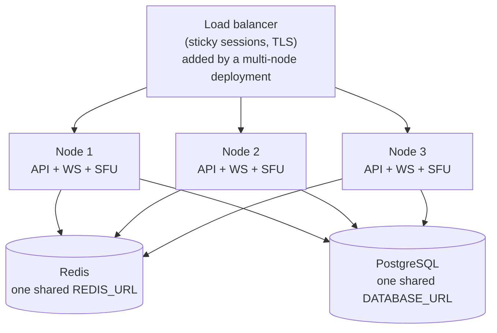

What the code supports (validated live: 35/35 cross-node scenarios in `scripts/test-multi-node.ts`, including real RTP and hard owner-crash takeover):
- Socket.IO Redis adapter for cross-node event distribution (4 Redis clients: data, pub, sub, configSub)
- Presence, DM-call, and voice-channel metadata fully in Redis; mediasoup objects stay node-local
- **Channel-affinity voice relay:** each voice channel's mediasoup Router lives on exactly ONE node (claimed atomically via `SET NX`); participants whose sockets live on other nodes are relayed over Redis pub/sub and represented on the owner node by shims. Clients send RTP straight to the owning node's announced IP — media bypasses the HTTP proxy
- **Node heartbeats + takeover:** `node:alive:{id}` keys (30s TTL) gate boot cleanups; a 60s reaper takes over channels owned by crashed peers
- **Presence reconciliation and scheduled jobs under cluster locks:** the 60s presence reaper and the scheduled jobs (cleanups, discovery stats, key-share retention) take a Redis cluster lock (`withClusterLock`, or an idempotent mutex of their own), so each runs once per interval across the cluster, not once per node; feature flags and rate-limit overrides propagate to every node over Redis pub/sub
- Cross-cluster room operations only (`socketsJoin`/`socketsLeave`/`io.in(room)`) — `fetchSockets()` is banned in hot paths (it waits on every node and throws when a peer is dead)

What a multi-node deployment must provide:
- **Sticky sessions** on the load balancer: the client opens Socket.IO with HTTP long-polling first and upgrades to WebSocket, so every request of the polling phase (and the upgrade) must reach the same node
- **One shared Redis and one shared PostgreSQL:** each node connects to a single `REDIS_URL` and a single `DATABASE_URL` (`utils/redis.ts`, `utils/prisma.ts`); there is no read-replica routing or Redis Sentinel/Cluster client in the code, so replication or failover has to sit behind that one address
- **Client-reachable WebRtcServer ports on every node** (`MEDIASOUP_ANNOUNCED_IP`, `MEDIASOUP_MIN_PORT`/`MAX_PORT`): RTP goes straight to the node that owns the channel, never through the load balancer
- **A unique `NODE_ID` per node:** heartbeats, voice-channel ownership and the boot cleanups are keyed on it (a random id is generated at each start when it is unset)

### Phase 3: Microservices (100K+ users)

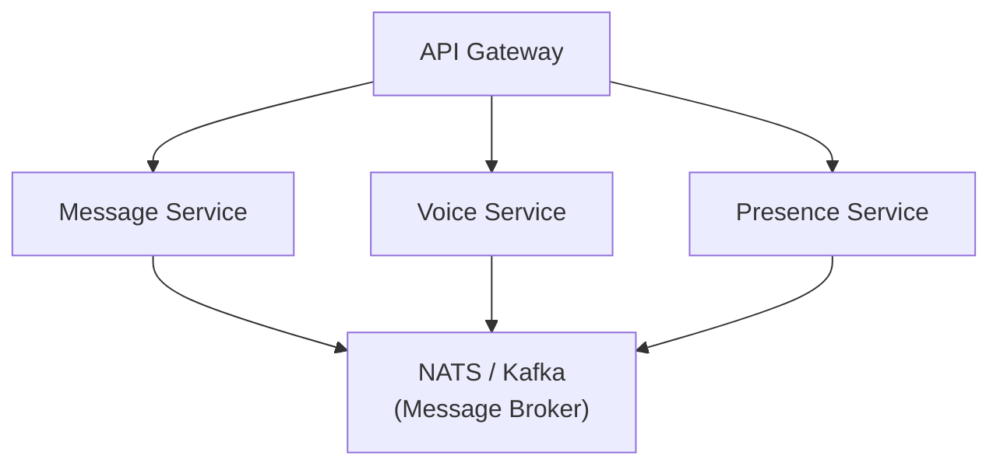

- Break into domain microservices
- Event-driven architecture with message broker
- Independent scaling of voice vs. text vs. API
- Dedicated media servers for voice/video

### Phase 4: Discord-Scale (Millions)

- Regional edge nodes operated by the deployment itself (media and asset serving close to users; no third-party CDN, per the principles above)
- Regional data centers
- Database sharding by server_id
- Dedicated media infrastructure
- Global service mesh
- Multi-region Redis clusters

---

## Deployment Architecture

### Development
```bash
docker compose up -d     # Redis + coturn (STUN); PostgreSQL runs locally
pnpm dev                 # Backend + admin + Tauri app (pnpm dev:web: backend + browser client)
```

### Production (Docker)

```dockerfile
# Dockerfile (repo root, multi-stage: build -> production; published to GHCR by docker.yml on v* tags). Simplified sketch:
FROM node:26-alpine
WORKDIR /app
COPY package.json pnpm-lock.yaml ./
RUN pnpm install --frozen-lockfile --prod
COPY dist/ ./dist/
COPY prisma/ ./prisma/
RUN npx prisma generate
CMD ["node", "dist/index.js"]
```

### Production (Kubernetes) — Future

```yaml
# Simplified deployment structure
API Deployment (3+ replicas)
  └── Service (ClusterIP)
      └── Ingress (nginx)

PostgreSQL StatefulSet
  └── PersistentVolumeClaim

Redis Deployment
  └── Service (ClusterIP)

mediasoup Deployment (autoscaling)
  └── Service (NodePort for UDP)
```

---

## Future Architecture

### Planned Features & Their Architectural Impact

| Feature | Architecture Change |
|---------|-------------------|
| **Video calls** | mediasoup SFU with video codecs (VP8/VP9/H264) |
| **~~Screen sharing~~** | ~~mediasoup producer for screen capture~~ **Implemented (v0.9.6)** — `getDisplayMedia()` capture produced into the mediasoup SFU (`screen-video` / `screen-audio` producers, claimed through an ACK'd `voice:screen_share:start`); one sharer per channel; inline + floating viewer modes; annotations and privacy masks since (see Screen-Share Annotations & Overlays) |
| **~~Direct Messages~~** | ~~New DM channel type, conversation model~~ **Implemented (v0.5.0–v0.7.0)** — 1-on-1 text + voice with `Conversation` model, real-time delivery, typing, reactions, unread tracking, WebRTC P2P calls, conversation deletion with cascade + real-time sync |
| **~~File uploads~~** | ~~S3-compatible object storage~~ **Implemented (v0.3.2, migrated v0.9.1, attachments v1.2.0)** — presigned URL direct-to-S3 uploads for avatars, server icons, and message attachments; attachments proxied through server (S3 URL never exposed); 3-day retention with daily 4 AM cleanup job + email report; soft-delete preserves DB records for "Expired" UI placeholders |
| **~~Password reset~~** | ~~Email-based reset flow~~ **Implemented (v0.4.0)** — Nodemailer + SHA-256 hashed tokens + tokenVersion-based session invalidation |
| **~~Push notifications~~** | ~~FCM/APNs integration service~~ **Partially implemented (v1.2.1)** — Native OS notifications with avatar support (WinRT toast on Windows, Web Notification API in browser); FCM/APNs for mobile remains future work |
| **~~Message search~~** | ~~Elasticsearch / PostgreSQL full-text search~~ **Implemented (v0.9.5)** — PostgreSQL case-insensitive `contains` search (trigram-indexed) across space channels and DM conversations; cursor-based pagination; "around" mode for jump-to-message with scroll + highlight; the search field sits in each chat header (`SearchField`) |
| **Mobile app** | React Native sharing stores/services with web |
| **Bot API** | Gateway API for third-party integrations |
| **~~End-to-end encryption~~** | ~~Signal Protocol for DMs~~ **Implemented** — Olm/Megolm (vodozemac, Rust/WASM `packages/crypto-engine`) for DMs, secure channels, secure voice and DM call signaling; see `docs/e2e-dm-spec.md` |

### Mobile Strategy

The frontend architecture is designed for code sharing:

```
packages/shared/     → Types, validators, constants (shared)
packages/ui/         → UI components (future, shared)
apps/desktop/        → Tauri + React (desktop); also the browser build (same code minus Tauri, `pnpm dev:web`)
apps/mobile/         → React Native (future)
apps/admin/          → React admin dashboard
```

Zustand stores and service layer (API + Socket) are framework-agnostic and can be reused across all platforms.
